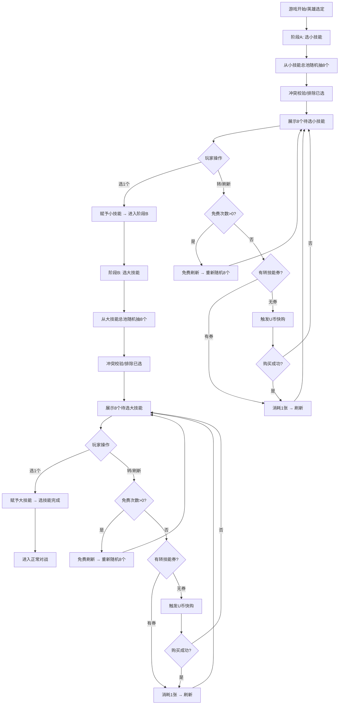
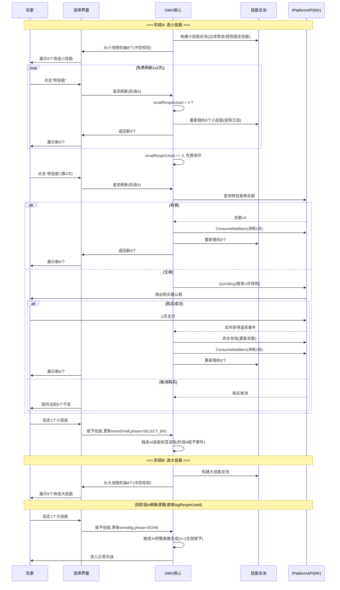
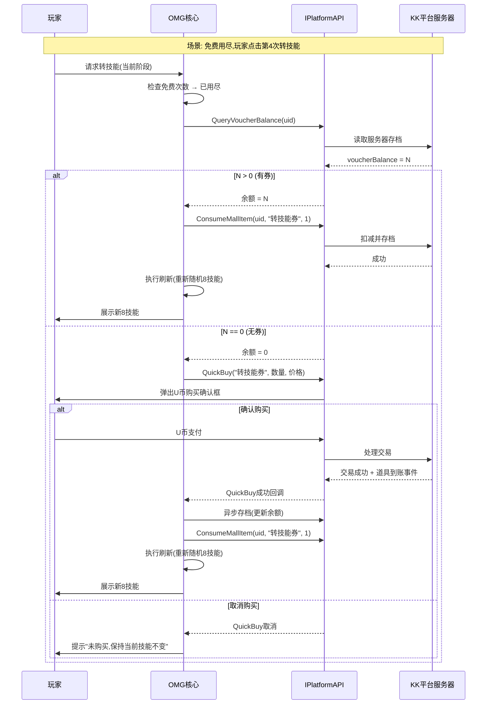
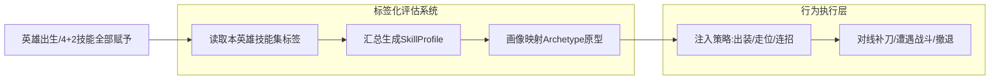
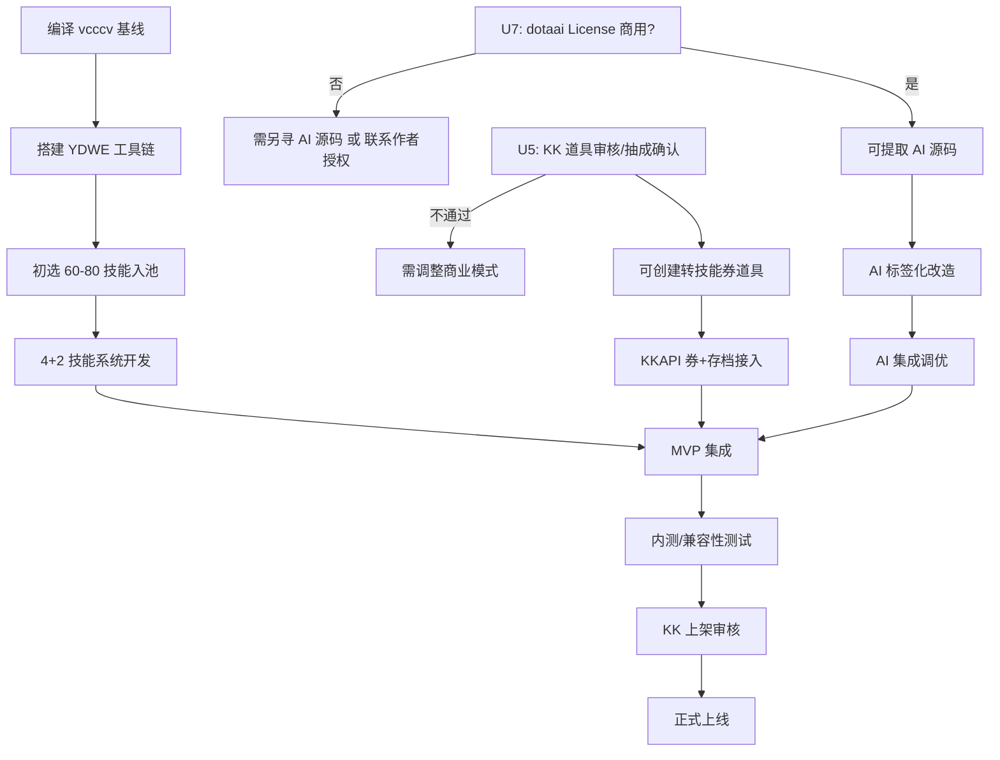

# DOTA1 OMG AI 地图 —— 产品需求文档（PRD）

> **项目代号**：DOTA1-OMG-AI  
> **撰稿**：产品经理 许清楚  
> **主理人**：齐活林 · 交付总监  
> **日期**：2026-10-14  
> **阶段**：产品需求定义（未进入编码阶段）  
> **目标平台**：KK 对战平台（主）/ 11 对战平台（辅，免费降级版）  
> **版本**：v1.0  
> **关联文档**：《DOTA1 OMG AI 地图 —— 调研报告与可行性方案 v1.1》

---

## 一、产品概述

### 1.1 产品定位

**DOTA1 OMG AI 地图** 是一张基于魔兽争霸 3（1.27a）引擎的自定义对战地图，核心玩法为 **4+2 分阶段技能征召模式**：每位玩家选定的英雄保留原版 4 个固定技能（3 小技能 + 1 大招），并分两阶段从全英雄技能总池中额外选择 1 个小技能和 1 个大招，构成独特的技能组合。地图内置 AI 对手，支持单人或少量玩家即可开局。

**一句话定位**：*"4+2 分阶段选技能 + 免费/付费转技能刷新 + AI 随机技能适配对战，面向 War3 老玩家的付费型 OMG 地图。"*

### 1.2 目标用户

| 用户群体 | 画像 | 核心诉求 |
|----------|------|----------|
| **核心玩家** | 30 岁以上"老男孩"，玩澄海 3C / 真三国无双 / 守卫剑阁长大，坚守 War3 生态 | 玩法深度、技能搭配自由度、操作手感、反复可玩性 |
| **AI 对战玩家** | 有碎片化时间，凑不齐 10 人，偏好单人或 3-5 人小局 | 随时开局、AI 难度可调、不被碾压的过渡体验 |
| **付费玩家** | 有稳定收入，付费意愿强且持续，ARPU 值高 | 为"更多选择机会"付费（转技能刷新），非为更强属性 |
| **定制玩家** | 追求个性化外观与独特技能组合的资深 OMG 玩家 | 自定义英雄外观、投稿定制技能、赛季排行荣誉 |

### 1.3 核心价值主张

1. **4+2 分阶段选技能——比经典 OMG 更精细的搭配自由度**：经典 OMG 是"全池选 4 技能"一把梭，本项目将选技能拆为"先选小技能再选大招"两阶段，每阶段独立刷新池，策略深度翻倍。
2. **免费 3 次 + 付费转技能——自走棋式刷新付费，竞技公平**：不满意当前 8 个可选技能可刷新重发，每阶段免费 3 次，超出后花"转技能券"刷新。付费获取的是"更多选择机会"而非"更强属性"，技能池对所有玩家相同，竞技公平不受影响。
3. **AI 随机技能适配——降低开局门槛**：自研"技能标签化评估系统"让 AI 动态识别随机到的技能并生成行为策略，支持单人开局，碎片化时间利用。

### 1.4 与竞品差异化定位

| 维度 | 竞品 dotaaiomg.cn | 本项目 | 差异化策略 |
|------|-------------------|--------|------------|
| 选技能模式 | 经典 OMG 全池选 4（-nengap） | **4+2 分阶段**（先小 8 选 1，再大 8 选 1） | 更精细的搭配策略 |
| 转技能 | 无刷新机制 | **免费 3 次/阶段 + 付费转技能券** | 自走棋式刷新付费 |
| 商业模式 | 免费无氪 + 网站打赏 | **平台内购（转技能券/外观/定制内容）** | 正规付费转化 |
| AI | 5 年调优，暴打普通玩家 | **追平可用**（标签化评估 + 5 原型） | MVP 不拼超越，先达可用 |
| 平台 | KK 为主，11 已停更 | **KK 主战场 + 11 辅战场（降级版）** | 双平台覆盖 |
| 外观定制 | -tx 武器/身体特效、-cb 翅膀 | 借鉴竞品，P1 级外观定制 | 借鉴竞品机制 |
| 工具生态 | 测试命令生成器/崩溃日志/许愿池/投票榜 | P2 级逐步补齐 | MVP 先聚焦核心 |

**差异化定位总结**：不与竞品拼"免费全池 OMG + 强 AI"，而是以 **4+2 分阶段玩法 + 付费转技能 + 后续定制扩展** 建立差异化，AI 目标"追平可用"而非超越。

---

## 二、用户故事

### 2.1 核心玩家场景

> **US-1**：作为一名 War3 老玩家，我想在每局游戏开始时分两阶段从全英雄技能池中选技能，这样我能体验到比经典 OMG 更精细的搭配策略，每次开局都有不同体验。

**验收标准**：
- 每局开始后进入阶段 A（选小技能），从全英雄小技能总池随机出 8 个，选 1 个
- 小技能选定后进入阶段 B（选大技能），从全英雄大技能总池随机出 8 个，选 1 个
- 英雄保留原版固定 4 技能（3 小 + 1 大），加上额外选的 2 技能（1 小 + 1 大），共 6 技能
- 两阶段均有时限控制（建议 120 秒/阶段），超时随机选

### 2.2 转技能场景

> **US-2**：作为一名追求完美技能组合的玩家，当当前 8 个可选技能不满意时，我想刷新池子重新发牌，前 3 次免费，之后可以用转技能券继续刷，这样我能在不破坏竞技公平的前提下获得更多选择机会。

**验收标准**：
- 每阶段（小技能阶段 / 大技能阶段）各有 3 次免费刷新机会，每局重置
- 第 4 次刷新起消耗 1 张"转技能券"
- 刷新 = 重新随机 8 个技能（重新发牌），不含当前已选技能
- 免费次数用尽且无券时，弹出 U 币快速购买确认框（KK 平台）
- 11 平台降级为免费无限刷新

### 2.3 付费玩家场景

> **US-3**：作为一名愿意付费提升体验的玩家，我想用 U 币在 KK 平台商城购买转技能券，在地图内即时消耗刷新技能池，不用退出游戏充值，这样付费体验流畅不打断游戏节奏。

**验收标准**：
- KK 平台商城上架"转技能券"道具（数量型），支持 U 币购买
- 地图内通过 KKAPI（DzAPI_Map_QuickBuy）触发 U 币快速购买
- 购买后实时获得道具事件 → 自动消耗 1 张 → 执行刷新
- 转技能券余额通过 KKAPI 服务器存档持久化，跨局保留
- 11 平台 KKAPI 不生效，降级为免费无限刷新

### 2.4 AI 对战场景

> **US-4**：作为一名碎片化时间较多的玩家，我想在凑不齐 10 人时用 AI 补位开局，AI 能根据随机到的技能合理出装和战斗，不会卡死或挂机，这样我随时都能开局体验。

**验收标准**：
- 支持 1 人开局 + 9 个 AI 补位
- AI 通过"技能标签化评估系统"动态识别随机到的技能，生成 SkillProfile 画像
- AI 匹配 5 种原型之一（爆发法师 / 坦克控制 / 核心续航 / 游走刺客 / 辅助控制），执行对应策略
- AI 行为要求：不卡死、不出装停滞、不挂机不动；对线能补刀、遭遇能战斗、低血能撤退
- AI 难度可调（P1 级，借鉴竞品 -cg X 机制）

### 2.5 定制玩家场景

> **US-5**：作为一名追求个性化的资深玩家，我想定制英雄外观（武器特效/翅膀）并保存多套技能搭配预设，后续甚至能投稿自制技能，这样我的游戏体验持续有新鲜感。

**验收标准**：
- 外观定制（P1 级，借鉴竞品 -tx/-cb）：可选武器/身体特效、翅膀外观，不影响数值
- 技能预设保存（P1 级）：保存多套技能搭配方案，扩展槽位可付费
- 定制技能投稿（P2 级）：玩家设计技能 → 作者审核上架 → 付费解锁
- 定制英雄模型（P2 级）：外观差异，不影响数值
- 赛季通行证 + 排行榜（P2 级）

---

## 三、需求池（P0/P1/P2 分级）

### 3.1 P0 —— 必须实现（MVP 上架必需）

| 编号 | 需求 | 描述 | 验收标准 |
|------|------|------|----------|
| P0-01 | 4+2 分阶段选技能 | 英雄固定 4 技能（3 小+1 大）+ 分两阶段额外选 2 技能（1 小+1 大） | 阶段 A 从小技能总池随机 8 个选 1；阶段 B 从大技能总池随机 8 个选 1；两阶段独立；技能池=所有英雄技能汇总 |
| P0-02 | 免费转技能 3 次/阶段/局 | 每阶段可免费刷新（重新发牌）3 次，每局重置 | 小技能阶段 3 次免费刷新；大技能阶段 3 次免费刷新；新局重置；刷新=重新随机 8 个不含已选技能 |
| P0-03 | 转技能券付费购买 | KK 平台商城道具"转技能券"（数量型），U 币购买，地图内 KKAPI 消耗 | KK 开发者平台创建道具；DzAPI_Map_QuickBuy 快购；DzAPI_Map_ConsumeMallItem 消耗；实时获得事件→执行刷新 |
| P0-04 | 基础 AI（5 原型 + 标签化） | 技能标签化评估系统 + 5 种行为原型 + 对线/连招/撤退 | AI 动态识别随机技能→生成 SkillProfile→匹配原型→执行策略；不卡死/不挂机/行为合理 |
| P0-05 | 服务器存档 | KKAPI 服务器存档，持久化转技能券余额/战绩统计 | 跨局保留券余额；DzAPI 存档接口；11 平台降级无存档 |
| P0-06 | IPlatformAPI 抽象层 | 统一平台接口抽象，KK 接 KKAPI，11 接空实现降级 | 业务代码不直接依赖平台 API；KK 启用完整功能；11 降级免费无限刷新 |

### 3.2 P1 —— 应该实现（上架后首批迭代）

| 编号 | 需求 | 描述 | 验收标准 |
|------|------|------|----------|
| P1-01 | AI 难度调节 | 借鉴竞品 -cg X 机制（X=1-1000），动态调整 AI 经验/金钱加成 | 玩家可选 AI 难度档位；难度影响 AI 资源加成；-neng 切回正常 |
| P1-02 | 技能冲突规则库 | 法球/变身/重击/切换型技能冲突规则（借鉴竞品踩坑） | 冲突组定义 + 策略（单生效/禁选/特殊处理）；选技能时冲突校验；切换型技能可用（预防竞品 -fixskill） |
| P1-03 | 技能预设保存 | 保存多套技能搭配方案，扩展槽位可付费 | 基础 1 个免费槽位；扩展 3 个槽位付费（6 元）；存档持久化 |
| P1-04 | 外观定制 | 借鉴竞品 -tx/-cb，武器/身体特效 + 翅膀外观，不影响数值 | 可选外观项；纯视觉不影响属性；服务器存档记录选择 |

### 3.3 P2 —— 锦上添花（长期迭代）

| 编号 | 需求 | 描述 | 验收标准 |
|------|------|------|----------|
| P2-01 | 定制技能（玩家投稿） | 玩家设计技能→作者审核上架→付费解锁→纳入技能总池 | ICustomContentProvider 接口；审核流程；存档标记解锁；新 SkillDef 自动纳入选择/AI/冲突 |
| P2-02 | 定制英雄模型 | 外观差异，不影响数值 | 新 HeroDef 条目自动加载；AI 基于画像不依赖英雄 ID |
| P2-03 | 赛季通行证 | 赛季任务 + 奖励 + 排行 | 赛季周期；任务系统；排行榜 |
| P2-04 | 排行榜 | 胜率/场次/连胜等排行 | 服务器统计；按赛季/总榜展示 |
| P2-05 | 许愿池/技能投票 | 借鉴竞品工具生态，玩家投票期望加入的技能 | 网站端提交→定期统计→作者采纳 |
| P2-06 | 崩溃日志上报 | 借鉴竞品崩溃日志机制 | 地图崩溃时自动上报；作者后台查看 |
| P2-07 | AI 增强（团战配合） | 团战配合 + 动态出装 + 扩展到 8 原型 | 团战行为树；动态出装策略；8 原型覆盖 |
| P2-08 | 复活节奏调节 | 借鉴竞品 -sr/-dr/-gr 机制 | 快速/慢速/动态递增复活；可选胜利条件（人头数） |

---

## 四、核心功能详述

### 4.1 4+2 分阶段选技能流程

#### 4.1.1 总体流程



#### 4.1.2 选技能时序图（含转技能+付费流程）



#### 4.1.3 关键规则

| 规则 | 说明 |
|------|------|
| 技能池来源 | 所有英雄的技能汇总成一个总随机池，按小技能/大技能分两个子池 |
| 抽取数量 | 每阶段从对应子池随机抽 8 个 |
| 排除规则 | 排除当前英雄已固定的技能；排除已选技能；冲突组校验 |
| 免费次数 | 每阶段 3 次/局，每局重置（非终身） |
| 转技能语义 | 转 = 刷新当前阶段的 8 技能随机池（重新发牌）；选技能动作不消耗次数 |
| 被动重生 | 转技能刷新池后，重新赋予的被动需处理旧被动移除/新被动赋予（实现阶段处理，避免残留） |
| 超时处理 | 每阶段 120 秒时限，超时随机选 1 个（假设，待确认） |
| 英雄固定技能 | **假设**：英雄固定 4 技能 = 原版 3 小 + 1 大（额外选的大技能即第 2 个大招，共 4 小 + 2 大，类似 LoD -s6） |

### 4.2 转技能券付费机制

#### 4.2.1 KK 商城道具映射

| 概念 | KKAPI 实现 |
|------|------------|
| 转技能券 | KK 开发者平台创建道具「转技能券」（数量型道具） |
| 玩家购买 | U 币在平台商城购买（3 次/6 次/10 次礼包） |
| 地图内消耗 | `DzAPI_Map_ConsumeMallItem`，每次转技能消耗 1 张 |
| 快速购买 | `DzAPI_Map_QuickBuy`，U 币快购弹框，不退出游戏 |
| 实时获得 | 快购成功后实时获得道具事件 → 自动消耗执行刷新 |
| 持久化 | KKAPI 服务器存档，跨局保留券余额 |
| 作者发放 | 平台后台/轻量服务端发放（活动赠送等） |

#### 4.2.2 付费时序图



#### 4.2.3 11 平台降级方案

| 项 | KK 平台 | 11 平台（降级） |
|----|---------|----------------|
| 转技能刷新 | 免费 3 次 + 付费 | **免费无限** |
| 商城道具 | KKAPI 商城 | 不生效 |
| 服务器存档 | KKAPI 存档 | 无（本地 Preload 降级，不推荐用于付费数据） |
| IPlatformAPI | KKPlatformAPI（完整实现） | Platform11API（空实现/降级实现） |

### 4.3 AI 系统需求

#### 4.3.1 核心难点与解决思路

**问题本质**：原版 AI（wrsuperboy/dotaai，3.3 万行）是"固定技能→固定策略"脚本，OMG 下技能随机，AI 不认识自己的技能。

**解决方案（创新点）**：运行时根据随机到的技能标签动态生成画像（SkillProfile），匹配行为原型（Archetype），注入策略。



#### 4.3.2 技能标签定义（SkillDef AI 标签字段）

| 标签字段 | 类型 | 说明 |
|----------|------|------|
| dmgType | PHYSICAL / MAGICAL / PURE | 伤害类型 |
| dmgScale | 0-10 | 伤害量级 |
| ctrlMask | 位掩码(STUN/SLOW/SILENCE/DISARM...) | 控制类型 |
| ctrlDuration | 秒 | 控制时长 |
| healScale | 0-10 | 治疗/续航量级 |
| isPassive | bool | 是否被动 |
| isDash | bool | 是否位移 |
| rangeCat | MELEE/SHORT/LONG/GLOBAL | 射程分类 |
| cooldownTier | 枚举 | 冷却档位 |

#### 4.3.3 SkillProfile（技能画像汇总）

```
SkillProfile {
  burstScore       // 爆发分 0-10
  sustainScore     // 续航分
  controlScore     // 控制分
  mobilityScore    // 机动分
  durabilityScore  // 承伤分
}
```

#### 4.3.4 五种行为原型（初版）

| 原型 | 触发条件 | 出装方向 | 连招逻辑 |
|------|----------|----------|----------|
| 爆发法师 | burst≥7 且魔法为主 | 法系爆发 | 先手控制→连招秒杀→撤退 |
| 坦克控制 | control≥6 且 durability≥5 | 肉+控制 | 开团→吸收→持续控制 |
| 核心续航 | sustain≥6 且物理为主 | 攻速暴击 | 残血续航→收割 |
| 游走刺客 | mobility≥4 且 burst≥5 | 穿透爆发 | 位移切入→秒杀→撤离 |
| 辅助控制 | control≥5 且 heal≥3 | 团队装 | 控制→治疗→辅助 |

**连招执行逻辑（标签驱动）**：
1. 先手：找眩晕控制技能 → 施放
2. 爆发：找最高伤害技能 → 施放
3. 残血：找治疗/护盾技能 → 施放
4. 撤退：找位移技能 → 施放撤离

#### 4.3.5 AI 难度调节（P1 级，借鉴竞品 -cg X 机制）

| 机制 | 借鉴来源 | 说明 |
|------|----------|------|
| -cg X（动态加成） | 竞品 dotaaiomg | X=1-1000，每点提高 AI 动态经验/金钱加成 |
| -neng（切回正常） | 竞品 dotaaiomg | 切回无加成正常难度 |
| -fl（分路推进） | 竞品 dotaaiomg | AI 16 级后分路推进 |
| -fuck（行为增强） | 竞品 dotaaiomg | 更积极用物品技能/关闭打野 |
| 难度档位 | 本项目设计 | 简化 5 档（新手/简单/普通/困难/噩梦），映射到 X 值范围 |

#### 4.3.6 AI 行为要求（MVP 基线）

| 行为 | 要求 | 验收 |
|------|------|------|
| 对线 | 能补刀（正补/反补），不被远兵白嫖 | 10 分钟补刀数≥简单档 20/困难档 40 |
| 遭遇 | 能识别敌我，释放技能战斗 | 不站着挨打，技能释放率≥60% |
| 撤退 | 低血量能撤回塔/基地 | 血量<20%时撤退率≥80% |
| 出装 | 按原型出装路线购买 | 不出装停滞（预防竞品 AI 脚本缺失导致挂机） |
| 防卡死 | 不长时间原地不动/卡路径 | -aiunstuck 预防（借鉴竞品），架构层加超时检测+强制位移 |

### 4.4 技能冲突规则

#### 4.4.1 冲突规则表（借鉴竞品踩坑经验）

| 冲突类型 | 策略 | 示例技能 | 借鉴来源 |
|----------|------|----------|----------|
| 法球/攻击特效 | 同组单生效（取最高优先级） | 智慧之刃、法力损毁、腐蚀攻击 | 竞品踩坑 |
| 变身类 | 全局禁选同组第二个（或特殊处理） | 德鲁伊变熊、龙骑真龙形态、美杜莎分裂箭 | 竞品已解决 |
| 重击类 | 同组单生效 | 虚空时间锁定、火枪爆头、鱼人重击 | 竞品踩坑 |
| 切换型技能 | 架构预防（不能选了用不了） | 竞品 -fixskill 修复的切换型技能 | 竞品 -fixskill |
| 暂停/眩晕残留 | 统一状态清理（选技能/转技能时） | 竞品 -fixstun 修复的眩晕残留 | 竞品 -fixstun |
| 模型异常/消失 | 换技能/变身时统一模型管理 | 竞品 -fixmodel/-fixunit | 竞品踩坑 |
| 永久负面状态残留 | buff/debuff 统一清理 | 竞品 -fixstate | 竞品踩坑 |
| 分身单位头像异常 | 分身单位管理（地卜师/电狗） | 竞品 -fixdbs/-fixdg | 竞品踩坑 |
| 需弹道系统 | 兼容补丁或暂禁 | 窒息之刃+远程动态暴击 | 技术调研 |
| 卡尔元素/地卜师大招 | 特殊处理 | 卡尔冰雷火/元素召唤、地卜师大招 | 竞品踩坑 |

#### 4.4.2 冲突规则数据结构

```
ConflictRule {
  groupId             // 冲突组ID
  policy              // 0=同组单生效 | 1=全禁选 | 2=特殊处理
  members[]           // 成员技能ID列表
  priority[]          // 优先级(同组单生效时取最高)
}
```

#### 4.4.3 冲突校验时机

| 时机 | 操作 |
|------|------|
| 技能池构建 | 按冲突组建索引 |
| 随机抽 8 个 | 冲突校验：同组只出 1 个（除非 policy=2 特殊处理） |
| 选技能赋予 | 再次校验：已选技能与待选技能是否冲突 |
| 转技能刷新 | 重新随机时重新冲突校验 |

**核心原则**：竞品用"修复命令"（-fixskill/-fixstun/-fixmodel 等）兜底，说明这些坑难以根治。本项目须在**架构层预防**而非靠命令补救。

### 4.5 外观定制（P1 级，借鉴竞品）

| 外观项 | 借鉴来源 | 说明 |
|--------|----------|------|
| 武器/身体特效 | 竞品 -tx 1-35 | 纯视觉，不影响数值 |
| 翅膀外观 | 竞品 -cb | 纯视觉，不影响数值 |
| 选择方式 | 竞品命令式 → 本项目 UI 面板式 | 更友好的选择界面 |
| 持久化 | 服务器存档（KKAPI） | 跨局保留外观选择 |
| 11 平台 | 本地存档降级 | 仅本地有效 |

---

## 五、非功能需求

### 5.1 性能

| 项 | 要求 |
|----|------|
| 选技能阶段帧率 | ≥30 FPS（8 技能面板渲染+交互） |
| 正常对战帧率 | ≥30 FPS（10 人+AI 同屏团战） |
| 技能赋予延迟 | ≤200ms（选技能→获得技能效果） |
| 转技能刷新延迟 | ≤500ms（含随机+冲突校验+渲染） |
| AI 决策频率 | 每秒至少 1 次行为评估 |
| 地图加载时间 | ≤30 秒（含技能池构建） |

### 5.2 内存泄漏防护

| 项 | 要求 |
|----|------|
| handle 管理 | 遵循"创建→使用→销毁"生命周期规范，禁止裸创建不回收 |
| leak checker | 开发期启用 leak checker 扫描，定期审计 |
| 封装自动清理 | 对 timer/location/effect/group 等 handle 封装自动清理工具类 |
| 转技能被动重生 | 刷新池时统一处理旧被动移除（避免被动效果残留堆积） |
| 状态清理 | 选技能/转技能/换技能时统一清理 buff/debuff/stun 等状态（预防竞品 -fixstun/-fixstate） |
| 长时间运行 | 连续 10 局不崩溃（内测验收标准） |

### 5.3 版本兼容

| 项 | 要求 |
|----|------|
| 魔兽版本 | 仅支持 1.27a（与 vcccv/DOTAOMGAY 一致） |
| 版本检测 | 加载时检测魔兽版本，不兼容时提示 |
| 发布说明 | 明确标注"仅支持 1.27a" |
| 1.24e/1.20 | 不支持（大地图限制） |

### 5.4 跨平台降级

| 项 | KK 平台 | 11 平台 |
|----|---------|---------|
| 转技能 | 免费 3 次+付费 | 免费无限 |
| 商城道具 | KKAPI 商城 | 不生效 |
| 服务器存档 | KKAPI 存档 | 本地 Preload 降级 |
| IPlatformAPI | KKPlatformAPI（完整） | Platform11API（降级/空实现） |
| AI 功能 | 完整 | 完整（不降级） |
| 外观定制 | 服务器存档 | 本地存档 |

**核心原则**：业务代码不直接依赖平台 API，统一通过 IPlatformAPI 抽象层调用。

### 5.5 反作弊

| 项 | 要求 |
|----|------|
| 敏感数据 | 转技能券余额、付费数据放服务端（KKAPI 服务器存档） |
| 本地存档 | 仅用于外观选择等非敏感数据 |
| 改图防护 | KK 平台 KAC 系统封禁改图工具（平台侧） |
| 地图分发 | 仅通过 KK/11 平台正规渠道，禁止第三方下载器 |

---

## 六、商业化设计

### 6.1 转技能券定价

| 道具 | 价格 | 内容 | 定位 |
|------|------|------|------|
| 转技能券·单次 | 3 元/次 | 1 次转技能 | 应急单刷 |
| 转技能券·3 次包 | 6 元 | 3 次转技能 | 核心付费包（性价比最优） |
| 转技能券·6 次包 | 12 元 | 6 次转技能 | 中度玩家 |
| 转技能券·10 次包 | 18 元 | 10 次转技能 | 重度玩家（最划算） |

**定价逻辑**：参考自走棋刷新付费（3 元/次为行业常见锚点），批量购买有折扣，引导玩家买包不买单。

### 6.2 付费转化漏斗

```
进入地图玩家(100%)
    ↓
体验免费 3 次转技能(80%) — 绝大多数会用到免费刷新
    ↓
产生付费意愿(25-35%) — 对技能搭配有追求的核心玩家
    ↓
首次付费(8-15%) — 购买首个转技能券包
    ↓
持续付费(3-6%) — 重度玩家定期购买
```

**转化率参考依据**：
- OMG 用户付费意愿强（47% 玩家追求"强势技能组合"）
- 自走棋刷新付费模式已被市场验证
- 目标用户（30+ 老男孩）ARPU 值高且持续

### 6.3 后续付费扩展路线

| 版本 | 付费内容 | 说明 |
|------|----------|------|
| V1.0 | 转技能券包（3/6/10 次） | 核心付费点 |
| V1.5 | 技能预设扩展槽位（6 元/3 槽） | 保存多套搭配方案 |
| V1.5 | AI 难度选择（免费/付费分级） | 基础免费，高难付费（假设，待确认） |
| V2.0 | 定制技能（玩家投稿，付费解锁） | 作者审核上架，分成 |
| V2.5 | 定制英雄模型（外观，不影响数值） | 借鉴竞品 -tx/-cb 方向 |
| V3.0 | 赛季通行证 | 赛季任务+奖励+排行 |

### 6.4 竞技公平性保障

| 原则 | 说明 |
|------|------|
| 付费≠更强属性 | 转技能付费获取"更多选择机会"而非"更强技能"，技能池对所有玩家相同 |
| 外观≠数值 | 定制外观仅视觉差异，不影响属性 |
| 免费也能玩 | 免费 3 次/阶段刷新足以体验核心乐趣，付费是"更多机会"而非"必须" |

### 6.5 收益预估（参考调研报告）

| 情景 | 月 DAU | 付费转化 | ARPPU | 月平台总流水 | 月作者到手(50-70%) | 年化到手 |
|------|--------|----------|-------|-------------|-------------------|----------|
| 悲观 | 3K-8K | 5% | 8-12 元 | 1.2K-4.8K | 0.6K-3.4K | 0.7 万-4 万 |
| 中性 | 10K-25K | 8-10% | 12-20 元 | 9.6K-50K | 4.8K-35K | 5.8 万-42 万 |
| 乐观 | 30K-60K | 12-15% | 20-35 元 | 72K-315K | 36K-220K | 43 万-265 万 |

**核心变量**：AI 质量。AI 达"追平可用"→中性情景；AI 优秀成品类头部→乐观情景。

---

## 七、待确认问题清单

| 编号 | 问题 | 当前状态 | 假设/待核实 |
|------|------|----------|-------------|
| U1 | 免费 3 次是每局还是终身 | ✅ 已确认 | 每局重置 |
| U2 | 选技能口径 | ✅ 已确认 | 4+2 分两阶段：先小技能 8 选 1（可转 3 次），再大技能 8 选 1（可转 3 次） |
| U3 | 1 小+1 大比例是否固定 | ✅ 已确认 | 固定 1+1 |
| U4 | 转技能语义 | ✅ 已确认 | 转=刷新当前阶段 8 技能随机池；被动重生刷新留实现阶段处理 |
| U5 | KK 平台道具审核周期与抽成 | ⏳ 待核实 | 注册开发者后确认。**假设**：审核周期 1-2 周，抽成 30-50%（作者到手 50-70%） |
| U6 | 11 平台是否允许引导去 KK | ⏳ 待核实 | 上架前确认。**假设**：不允许直接引导，可做品牌曝光 |
| U7 | wrsuperboy/dotaai License 是否商用 | ⏳ 待核实 | 提取源码前必查。**假设**：MIT 或类似宽松协议，允许商用 |
| U8 | 英雄固定 4 技能口径 | ⏳ 待确认 | **假设**：英雄固定 4 技能 = 原版 3 小+1 大（额外选的大技能即第 2 个大招，共 4 小+2 大，类似 LoD -s6） |
| U9 | 选技能阶段时限 | ⏳ 待确认 | **假设**：每阶段 120 秒，超时随机选（借鉴竞品 120 秒选技能） |
| U10 | AI 难度选择是否付费 | ⏳ 待确认 | **假设**：基础难度免费，高难度档位付费（待商业模式验证后定） |
| U11 | 转技能券具体定价 | ⏳ 待确认 | **假设**：3 元/次，6 元/3 次，12 元/6 次，18 元/10 次（参考自走棋刷新锚点） |
| U12 | KK 作者分成具体比例 | ⏳ 待核实 | **假设**：50-70%（调研报告估"行业两倍以上"），待注册后确认 |

---

## 八、风险与依赖

### 8.1 风险矩阵

| 编号 | 风险 | 等级 | 影响 | 应对 |
|------|------|------|------|------|
| R1 | 技能组合兼容性工程量巨大 | 🔴 高 | 决定 MVP 能否按时交付 | 起步小技能池 60-80 个逐步扩展；自动化冲突测试；复用 vcccv 已有兼容成果；借鉴竞品踩坑方案 |
| R2 | AI 适配 OMG 随机技能（社区无先例） | 🔴 高 | 决定 AI 可用性 | 技能标签化评估系统（创新点）；先 5 原型覆盖；持续调优阈值；MVP 目标"不卡死、行为合理" |
| R3 | 跨平台 API 差异 | 🟡 中 | 影响 11 平台降级 | IPlatformAPI 抽象层；11 平台降级免费无限刷新 |
| R4 | 内存泄漏（handle 累积崩溃） | 🔴 高 | 影响长时间运行稳定性 | handle 管理规范；leak checker 扫描；封装自动清理；状态统一清理（预防竞品 -fixstun/-fixstate） |
| R5 | 版本兼容（仅 1.27a） | 🟡 中 | 限制用户范围 | 加载时版本检测；发布说明明确标注 |
| R6 | 版权合规（Blizzard 地图版权/Valve 商标） | 🟡 中 | 影响上架 | 不脱离平台独立发行；上架平台获版权背书；地图名避免独立使用"DOTA"商标（可用"OMG"或自创名） |
| R7 | 3.3 万行 AI 移植量 | 🟡 中 | 影响 MVP 周期 | 分阶段提取→标签化→调优；回归测试基线 |
| R8 | 4+2 分阶段被动重生处理 | 🟡 中 | 技能残留 bug | 转技能刷新时统一处理旧被动移除/新被动赋予 |
| R9 | 切换型技能兼容（竞品 -fixskill 坑） | 🟡 中 | 选了技能用不了 | 架构层预防，不靠修复命令兜底；冲突规则库覆盖 |
| R10 | AI 卡死（竞品 -aiunstuck 坑） | 🟡 中 | AI 行为死锁 | 架构层超时检测+强制位移；路径/行为死锁预防 |
| R11 | 平台审核不通过 | 🟡 中 | 延迟上架 | 遵守 KK 平台审核规范；U5 待核实后调整 |
| R12 | 竞品免费导致付费转化低 | 🟡 中 | 收入不及预期 | 差异化定位（4+2 分阶段+付费转技能）；11 平台免费引流到 KK 付费 |

### 8.2 外部依赖

| 依赖项 | 来源 | 状态 | 风险 |
|--------|------|------|------|
| OMG 源码 vcccv/DOTAOMGAY | GitHub | ✅ 可用 | License 需查（假设 MIT/宽松） |
| AI 源码 wrsuperboy/dotaai | GitHub | ✅ 可用 | License 需查（U7 待核实） |
| KKAPI 开发者平台 | https://create.reckfeng.com/ | ⏳ 待注册 | 需实名认证 |
| KKAPI 文档 | https://create.reckfeng.com/kkapidoc/ | ✅ 可查阅 | API 版本兼容 |
| MemoryHack | vcccv/DOTAOMGAY 已集成 | ✅ 可用 | 与 1.27a 绑定 |
| YDWE 工具链 | 社区工具 | ✅ 可用 | 版本兼容性 |
| KK 开发者 QQ 群 | 433807374 | ⏳ 待加入 | 平台政策跟进 |

### 8.3 关键路径依赖



---

## 附录 · PRD 与调研报告的映射关系

| PRD 章节 | 对应调研报告章节 |
|----------|-----------------|
| 产品概述 | 第一部分 1.1-1.4 |
| 用户故事 | 第一部分 1.2-1.3 |
| 需求池 | 第一部分 三（商业模式）+ 第二部分 全篇 |
| 核心功能-选技能 | 第二部分 二（OMG 技能系统改造方案） |
| 核心功能-转技能付费 | 第二部分 二.2.4 + 四（K 币/充值技术方案） |
| 核心功能-AI | 第二部分 三（AI 实现方案） |
| 核心功能-技能冲突 | 第二部分 二.2.5（冲突策略表） |
| 非功能需求 | 第二部分 六（技术风险 R3/R4/R5） |
| 商业化设计 | 第一部分 三（商业模式方案）+ 五（收益预估） |
| 待确认问题 | 第一部分 八（待明确事项） |
| 风险与依赖 | 第二部分 六（技术风险清单）+ 第一部分 四（合规与版权） |

---

*PRD v1.0 完。基于调研报告 v1.1 撰写，核心玩法口径已锁定。待核实 U5/U6/U7 后可进入 MVP 开发。*
