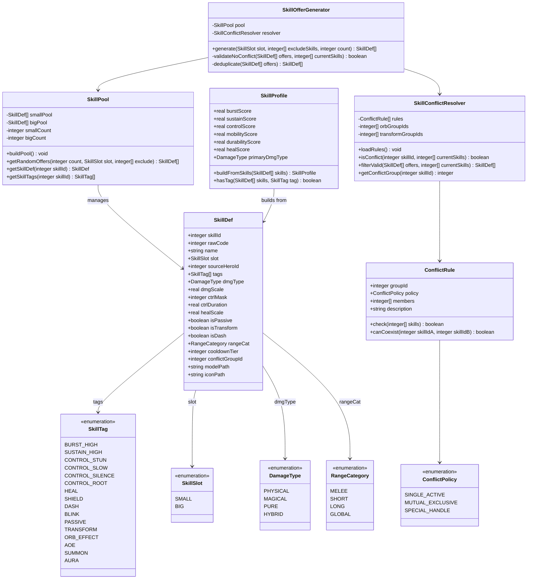
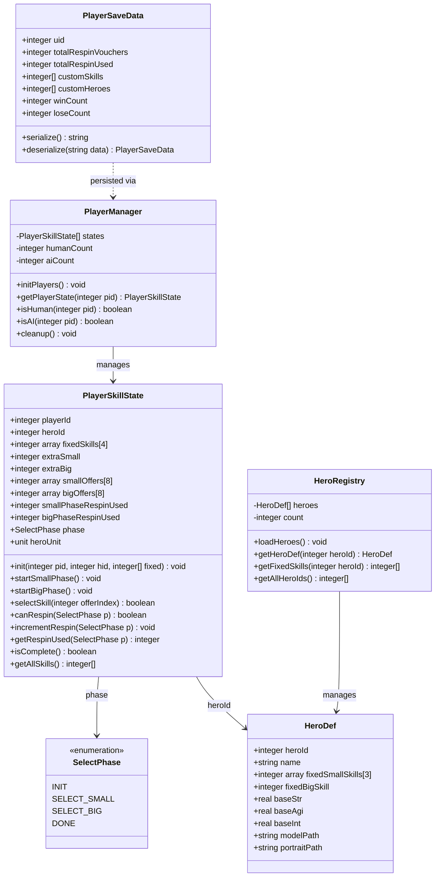
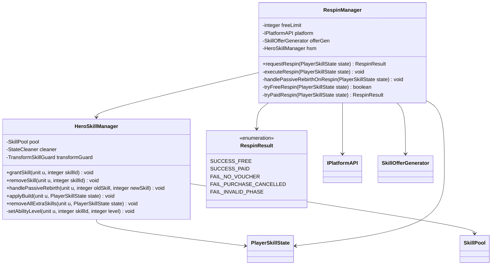
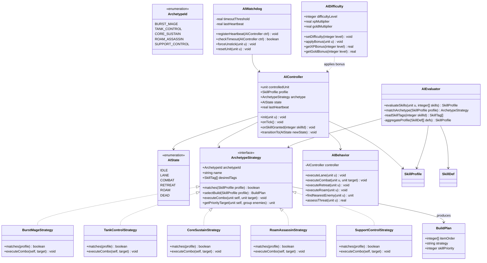
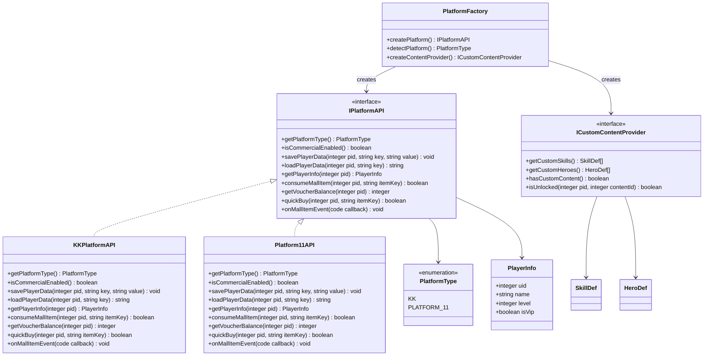
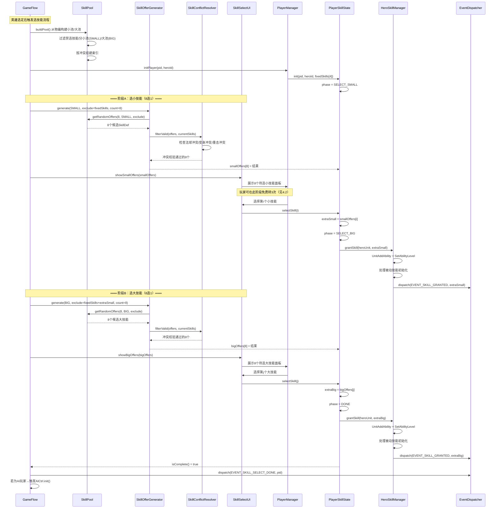
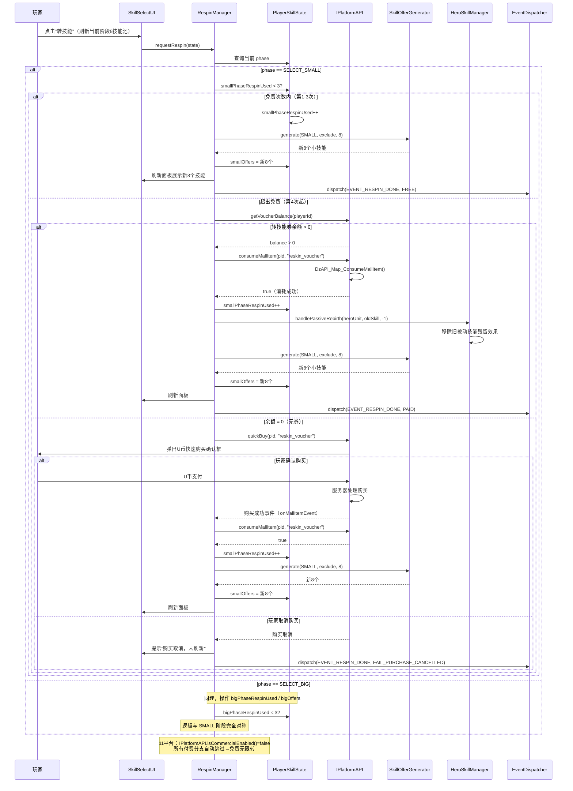
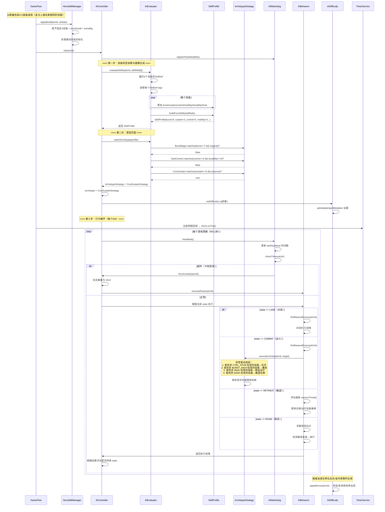
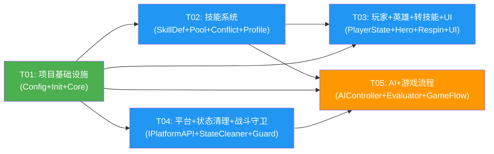

# DOTA1 OMG AI 地图 —— 完整技术方案

> **项目代号**：DOTA1-OMG-AI  
> **撰稿**：架构师 高见远  
> **日期**：2026-10-14  
> **目标平台**：KK 对战平台（主）、11 对战平台（辅，免费降级）  
> **技术栈**：JASS（vJASS/YDWE 扩展）+ 1.27a + MemoryHack + KKAPI  
> **状态**：技术方案（待工程师落地）


---

## 目录

- [一、实现方案与框架选型](#一实现方案与框架选型)
- [二、文件列表及相对路径](#二文件列表及相对路径)
- [三、数据结构和接口（类图）](#三数据结构和接口类图)
- [四、程序调用流程（时序图）](#四程序调用流程时序图)
- [五、任务列表（有序，含依赖关系）](#五任务列表有序含依赖关系)
- [六、依赖包与工具链列表](#六依赖包与工具链列表)
- [七、共享知识（跨文件约定）](#七共享知识跨文件约定)
- [八、竞品踩坑的架构预防方案](#八竞品踩坑的架构预防方案)
- [九、待明确事项](#九待明确事项)
- [十、任务依赖图](#十任务依赖图)

---

## 一、实现方案与框架选型

### 1.1 核心技术挑战

| #  | 挑战              | 难度    | 说明                                                                                     |
| -- | --------------- | ----- | -------------------------------------------------------------------------------------- |
| C1 | 技能组合兼容性工程量      | 🔴 极高 | OMG 模式下任意英雄可配任意技能，技能间冲突（法球叠加、变身冲突、重击不叠加等）需系统性检测与预防                                     |
| C2 | AI 适配随机技能       | 🔴 极高 | 传统 DOTA AI 为"固定英雄→固定技能→固定策略"硬编码，OMG 下技能随机，AI 必须运行时动态识别技能并决策——社区无现成方案                   |
| C3 | 平台双端适配          | 🟡 中  | KK 有完整 KKAPI（存档+商城+付费），11 无任何 API，需抽象层隔离                                               |
| C4 | 状态/模型/分身残留      | 🟠 高  | 竞品用 `-fixskill`/`-fixstun`/`-fixmodel`/`-fixstate`/`-fixdbs` 等修复命令兜底，说明这些坑难以根治，须在架构层预防 |
| C5 | 内存泄漏（handle 累积） | 🟠 高  | JASS 中动态创建的 handle（单位/特效/计时器/触发器）不手动销毁会累积导致崩溃                                          |
| C6 | 4+2 分阶段被动重生     | 🟡 中  | 转技能刷新池时旧被动需移除、新被动需赋予，时序敏感                                                              |

### 1.2 框架与库选型

| 组件        | 选型                | 版本/来源        | 选型理由                                                                |
| --------- | ----------------- | ------------ | ------------------------------------------------------------------- |
| 脚本语言      | JASS + vJASS      | 原生 + YDWE 扩展 | DOTA1 地图原生脚本语言，vJASS 提供 struct/interface/method 支持 OOP，YDWE 提供编译预处理 |
| 地图版本      | 1.27a             | Blizzard 官方  | vcccv/DOTAOMGAY 同版本，兼容性最稳定；1.24e 也可但 1.27a 为主流                      |
| 地图编辑器扩展   | YDWE              | 开源           | 支持 vJASS 编译、Lua 混合、导入管理、模板库；业界标准                                    |
| JASS 编译器  | jasshelper        | YDWE 内置      | vJASS → 原生 JASS 转译器                                                 |
| JASS 语法检查 | pjass             | 开源           | 编译前语法校验，减少运行时错误                                                     |
| Lua 运行时   | lua53             | YDWE 内置      | YDWE 支持部分逻辑用 Lua 编写再嵌入 JASS（如复杂配置解析）                                |
| 动态注册      | MemoryHack        | 开源           | 突破 JASS 原生限制，运行时动态新增物品/技能/原生函数；vcccv 已验证可用                          |
| 平台 SDK    | KKAPI             | KK 开发者平台     | 兼容 DzAPI，提供服务器存档 + 商城道具 + 轻量服务端 + 玩家信息                              |
| OMG 源码基线  | vcccv/DOTAOMGAY   | GitHub 开源    | 基于 LoD（OMG 本体），技能选择/随机框架现成，JAPI + MemoryHack 扩展                     |
| AI 源码基线   | wrsuperboy/dotaai | GitHub 开源    | 3.3 万行 AI 已从地图代码拆分，工程化程度最高，便于定位硬编码技能 ID                             |

### 1.3 架构模式

本方案采用三种核心架构模式：

**1) 数据驱动架构（Data-Driven）**

技能定义（SkillDef）、冲突规则（ConflictRule）、AI 标签（SkillTag）均以配置数据存储。新增/修改技能只需扩展 `SkillData.j` 配置，核心逻辑不变。这是后续"玩家定制技能/英雄"商业化的技术基础。

**2) 抽象层模式（Abstraction Layer）**

`IPlatformAPI` 接口屏蔽 KK 与 11 平台差异。业务代码只依赖接口，不直接调用 `DzAPI_*`。KK 运行时注入 `KKPlatformAPI` 实现（存档+付费），11 运行时注入 `Platform11API` 实现（空实现，自动降级为免费无限转）。

**3) 状态机模式（State Machine）**

- 技能选择流程用 `SelectPhase` 状态机管理（`INIT → SELECT_SMALL → SELECT_BIG → DONE`）
- AI 行为用状态机管理（`IDLE → LANE → COMBAT → RETREAT → DEAD`）
- 单位状态用 `UnitStateGuard` 守卫，防止异常状态残留

### 1.4 总体架构图

```mermaid
graph TB
    subgraph 地图资源层["地图资源层（物编/模型/图标）"]
        RES[物编数据<br/>技能/单位/物品定义]
    end

    subgraph 核心框架["核心框架 Core"]
        CFG[Config 全局配置]
        INIT[Init 初始化]
        EVT[EventDispatcher 事件分发]
        TMR[TimerService 定时器]
    end

    subgraph 技能系统["技能系统 SkillSystem"]
        SDEF[SkillDef 技能定义]
        SPOOL[SkillPool 技能总池]
        OFFER[SkillOfferGenerator 8选1生成]
        CONFLICT[SkillConflictResolver 冲突检测]
        HSM[HeroSkillManager 技能赋予]
        RESPIN[RespinManager 转技能]
        PROFILE[SkillProfile 技能画像]
    end

    subgraph AI系统["AI 系统"]
        AIC[AIController 控制器]
        EVAL[AIEvaluator 标签评估]
        ARCH[ArchetypeStrategy 原型策略]
        AIB[AIBehavior 行为执行]
        WATCH[AIWatchdog 看门狗]
    end

    subgraph 平台层["平台抽象层 Platform"]
        IPI["IPlatformAPI 接口"]
        KKPI[KKPlatformAPI KK实现]
        P11PI[Platform11API 11空实现]
    end

    subgraph 状态战斗["状态与战斗守卫"]
        SCLEAN[StateCleaner 状态清理]
        TGUARD[TransformSkillGuard 变身守卫]
        ILLUS[IllusionManager 分身管理]
        ORB[OrbEffectResolver 法球冲突]
    end

    RES --> SPOOL
    CFG --> INIT
    INIT --> SPOOL
    INIT --> IPI
    EVT --> SPOOL
    TMR --> AIC

    SPOOL --> OFFER
    OFFER --> CONFLICT
    OFFER --> HSM
    RESPIN --> OFFER
    RESPIN --> IPI
    HSM --> PROFILE
    HSM --> SCLEAN
    HSM --> TGUARD

    HSM -.技能赋予事件.-> AIC
    AIC --> EVAL
    EVAL --> PROFILE
    EVAL --> ARCH
    ARCH --> AIB
    AIC --> WATCH

    IPI <|-- KKPI
    IPI <|-- P11PI
```

---

## 二、文件列表及相对路径

以下为地图脚本源码的完整目录结构。所有 `.j` 文件使用 vJASS 语法，通过 YDWE 编译合并到 `war3map.j`。

```
map/
├── war3map.j                                  # [编译输出] 地图主入口脚本（YDWE 自动生成）
├── map_info/
│   ├── MapConfig.cfg                           # 地图基本配置（地图名/玩家数/地形等）
│   └── ImportList.imp                          # 资源导入清单
├── src/
│   ├── main.j                                  # [入口] vJASS 主入口，调用各模块 Init
│   │
│   ├── core/                                   # ===== 核心框架 =====
│   │   ├── Config.j                            # 全局配置常量（技能池大小/免费转次数/K币道具ID/各数值参数）
│   │   ├── Globals.j                           # 全局变量与数组声明
│   │   ├── Init.j                              # 地图初始化流程（读配置→建池→选平台→注册事件）
│   │   ├── TimerService.j                     # 定时器服务（帧循环/周期任务/清理回收）
│   │   ├── EventDispatcher.j                  # 事件分发器（技能赋予/选择完成/AI心跳等事件）
│   │   └── Logger.j                            # 日志服务（调试输出/崩溃日志/性能统计）
│   │
│   ├── skillsystem/                            # ===== 技能系统 =====
│   │   ├── SkillDef.j                          # 技能定义数据结构（技能属性+AI标签+冲突组）
│   │   ├── SkillTag.j                          # 技能标签枚举定义（BURST/SUSTAIN/CONTROL/HEAL/DASH等）
│   │   ├── SkillPool.j                         # 技能总池管理（从物编构建小池/大池/索引）
│   │   ├── SkillOfferGenerator.j              # 8技能随机抽取+冲突校验+去重
│   │   ├── SkillConflictResolver.j            # 冲突检测与解决（法球/变身/重击规则引擎）
│   │   ├── ConflictRule.j                      # 冲突规则定义与配置（数据驱动）
│   │   ├── SkillData.j                        # 技能数据配置（全部 SkillDef 条目，数据驱动核心）
│   │   ├── SkillProfile.j                     # 技能画像（从 SkillDef 标签汇总生成 burst/sustain/control 等评分）
│   │   ├── HeroSkillManager.j                 # 英雄技能赋予/移除/被动重生/模型切换
│   │   └── RespinManager.j                    # 转技能（刷新池）管理（免费次数+付费消耗逻辑）
│   │
│   ├── hero/                                   # ===== 英雄管理 =====
│   │   ├── HeroDef.j                           # 英雄定义（英雄ID/固定技能/基础属性/模型路径）
│   │   ├── HeroRegistry.j                     # 英雄注册表（全部 HeroDef 条目/查询接口）
│   │   └── HeroModelManager.j                 # 英雄模型/变身模型管理（防模型错乱/消失）
│   │
│   ├── player/                                 # ===== 玩家管理 =====
│   │   ├── PlayerSkillState.j                 # 玩家技能选择状态（4+2分阶段: phase/offers/respionUsed等）
│   │   ├── PlayerManager.j                    # 玩家管理（人类玩家/AI玩家/初始化/清理）
│   │   └── PlayerSaveData.j                   # 玩家存档数据结构（券余额/战绩/解锁内容）
│   │
│   ├── ai/                                     # ===== AI 系统 =====
│   │   ├── AIController.j                     # AI 控制器（主循环/状态机/技能赋予钩子）
│   │   ├── AIEvaluator.j                     # 技能标签评估器（读取标签→生成画像→匹配原型）
│   │   ├── ArchetypeStrategy.j                # 原型策略定义（5原型: 爆发法师/坦克控制/核心续航/游走刺客/辅助控制）
│   │   ├── AIBehavior.j                       # AI 行为执行（连招/走位/对线/团战/撤退）
│   │   ├── AIWatchdog.j                       # AI 看门狗（心跳检测/死锁判定/强制解除卡死）
│   │   ├── AIDifficulty.j                     # AI 难度机制（动态经验金钱加成 -cg X 1-1000）
│   │   └── AIPathing.j                        # AI 寻路与移动（路径死锁检测/绕行）
│   │
│   ├── platform/                              # ===== 平台抽象层 =====
│   │   ├── IPlatformAPI.j                     # 平台抽象接口（存档/商城/付费/玩家信息）
│   │   ├── KKPlatformAPI.j                    # KK 平台实现（KKAPI/DzAPI 服务器存档+商城道具消耗）
│   │   ├── Platform11API.j                    # 11 平台实现（空实现，全部降级为免费）
│   │   ├── ICustomContentProvider.j           # 自定义内容提供者接口（定制技能/英雄拉取）
│   │   └── PlatformFactory.j                  # 平台工厂（运行时检测平台→选择实现注入）
│   │
│   ├── ui/                                     # ===== UI 系统 =====
│   │   ├── UIManager.j                        # UI 管理器（多面板管理/界面切换/帧布局）
│   │   ├── SkillSelectUI.j                    # 技能选择界面（8选1面板/技能图标/描述/选择交互）
│   │   └── RespinUI.j                         # 转技能界面（刷新按钮/免费次数显示/付费购买入口）
│   │
│   ├── state/                                 # ===== 状态管理 =====
│   │   ├── StateMachine.j                     # 通用状态机（状态定义/转换/守卫/回调）
│   │   ├── StateCleaner.j                     # 状态清理器（buff/debuff/眩晕/暂停统一清理）
│   │   └── UnitStateGuard.j                   # 单位状态守卫（注册单位→周期巡检→异常修复）
│   │
│   ├── combat/                                 # ===== 战斗守卫 =====
│   │   ├── BuffCleaner.j                      # buff/debuff 清理（技能移除时关联状态清理）
│   │   ├── TransformSkillGuard.j              # 切换型技能守卫（变身兼容/形态切换/模型同步）
│   │   ├── IllusionManager.j                 # 分身单位管理（地卜师/电狗分身头像/属性同步）
│   │   └── OrbEffectResolver.j               # 法球/攻击特效冲突解决（同组单生效/优先级裁决）
│   │
│   └── game/                                   # ===== 游戏流程 =====
│       ├── GameFlow.j                          # 游戏流程控制（开局→选技能→对线→团战→结算）
│       ├── GameMode.j                          # 游戏模式配置（OMG模式/命令解析/-cg难度）
│       └── VictoryCondition.j                 # 胜利条件（人头数/基地摧毁/时间限制）
│
├── scripts/                                    # 构建与工具脚本
│   ├── build.sh                                # YDWE 编译构建脚本
│   ├── conflict_test.j                         # 自动化冲突测试（遍历技能两两组合检测崩溃）
│   └── leak_checker.j                          # 内存泄漏扫描（handle 计数/对比/告警）
└── config/                                     # 数据驱动配置文件
    ├── skills_data.lua                         # 技能数据配置（可被 SkillData.j 读取）
    ├── conflict_rules.lua                      # 冲突规则配置
    └── archetype_rules.lua                     # AI 原型匹配规则配置
```

**文件统计**：源码文件 42 个（含构建脚本和配置），核心逻辑文件 35 个。

---

## 三、数据结构和接口（类图）

> 以下用 Mermaid `classDiagram` 描述核心数据结构、服务类及其关系。JASS 非原生 OOP，但 vJASS 的 `struct`/`interface`/`method` 可实现等价设计。

### 3.1 技能系统核心类




### 3.2 玩家与英雄状态类



### 3.3 技能赋予与转技能管理



### 3.4 AI 系统类



### 3.5 平台抽象层与自定义内容



---

## 四、程序调用流程（时序图）

### 4.1 4+2 分阶段选技能流程




### 4.2 转技能（刷新）付费流程



### 4.3 AI 决策流程



---

## 五、任务列表（有序，含依赖关系）

### 5.1 任务总表

| 任务 ID | 任务名称                     | 源文件                                                                                                                                                                                                                                                                                                                                                                                              | 依赖            | 优先级 | 说明                                                              |
| ----- | ------------------------ | ------------------------------------------------------------------------------------------------------------------------------------------------------------------------------------------------------------------------------------------------------------------------------------------------------------------------------------------------------------------------------------------------ | ------------- | --- | --------------------------------------------------------------- |
| T01   | 项目基础设施（配置+入口+核心框架）       | `src/main.j`, `src/core/Config.j`, `src/core/Globals.j`, `src/core/Init.j`, `src/core/TimerService.j`, `src/core/EventDispatcher.j`, `src/core/Logger.j`, `map_info/MapConfig.cfg`                                                                                                                                                                                                               | 无             | P0  | 搭建 YDWE 项目骨架、全局配置常量、初始化流程、定时器服务、事件分发、日志。所有模块的基础                 |
| T02   | 技能系统（数据定义+池+选择+冲突+画像+赋予） | `src/skillsystem/SkillDef.j`, `src/skillsystem/SkillTag.j`, `src/skillsystem/SkillPool.j`, `src/skillsystem/SkillOfferGenerator.j`, `src/skillsystem/SkillConflictResolver.j`, `src/skillsystem/ConflictRule.j`, `src/skillsystem/SkillData.j`, `src/skillsystem/SkillProfile.j`, `src/skillsystem/HeroSkillManager.j`, `config/skills_data.lua`, `config/conflict_rules.lua`                    | T01           | P0  | 技能定义数据结构、技能总池构建、8选1生成、冲突检测解决、技能画像、技能赋予/移除/被动重生。OMG 核心玩法的基础      |
| T03   | 玩家+英雄+转技能+UI             | `src/player/PlayerSkillState.j`, `src/player/PlayerManager.j`, `src/player/PlayerSaveData.j`, `src/hero/HeroDef.j`, `src/hero/HeroRegistry.j`, `src/hero/HeroModelManager.j`, `src/skillsystem/RespinManager.j`, `src/ui/UIManager.j`, `src/ui/SkillSelectUI.j`, `src/ui/RespinUI.j`                                                                                                             | T01, T02      | P0  | 玩家4+2分阶段选技能状态机、英雄定义与注册、模型管理、转技能（免费+付费）逻辑、技能选择/转技能界面。直接面向玩家的核心交互 |
| T04   | 平台接入+状态清理+战斗守卫           | `src/platform/IPlatformAPI.j`, `src/platform/KKPlatformAPI.j`, `src/platform/Platform11API.j`, `src/platform/ICustomContentProvider.j`, `src/platform/PlatformFactory.j`, `src/state/StateMachine.j`, `src/state/StateCleaner.j`, `src/state/UnitStateGuard.j`, `src/combat/BuffCleaner.j`, `src/combat/TransformSkillGuard.j`, `src/combat/IllusionManager.j`, `src/combat/OrbEffectResolver.j` | T01           | P0  | 平台抽象层（KK付费/11降级）、状态清理体系、切换型技能守卫、分身管理、法球冲突解决。竞品踩坑的架构预防核心         |
| T05   | AI 系统+游戏流程集成             | `src/ai/AIController.j`, `src/ai/AIEvaluator.j`, `src/ai/ArchetypeStrategy.j`, `src/ai/AIBehavior.j`, `src/ai/AIWatchdog.j`, `src/ai/AIDifficulty.j`, `src/ai/AIPathing.j`, `src/game/GameFlow.j`, `src/game/GameMode.j`, `src/game/VictoryCondition.j`, `config/archetype_rules.lua`                                                                                                            | T01, T02, T04 | P1  | AI 标签化评估+5原型策略+行为执行+看门狗+难度机制、游戏流程编排、模式命令、胜利条件。技术难度最高的模块         |

### 5.2 任务粒度说明

| 规则           | 本方案遵循情况                                             |
| ------------ | --------------------------------------------------- |
| 最大任务数 ≤ 5    | ✅ 恰好 5 个                                            |
| 每任务至少 3 文件   | ✅ T01=8, T02=10, T03=10, T04=12, T05=11             |
| 第一个任务=项目基础设施 | ✅ T01 为配置+入口+核心框架                                   |
| 配置文件不分散      | ✅ 所有 `.cfg`/`.lua` 配置随对应功能模块分组                      |
| 依赖链尽量短       | ✅ T02/T04 仅依赖 T01；T03 依赖 T01+T02；T05 依赖 T01+T02+T04 |

### 5.3 各任务关键实现要点

**T01 · 项目基础设施**

- `Config.j`：定义 `SKILL_OFFER_COUNT=8`、`FREE_RESPIN_PER_PHASE=3`、`RESPIN_VOUCHER_KEY="reskin_voucher"`、玩家数、AI 数等全部可调常量
- `Init.j`：调用顺序 = `Config.load()` → `PlatformFactory.createPlatform()` → `SkillPool.buildPool()` → `HeroRegistry.loadHeroes()` → `PlayerManager.initPlayers()` → 注册 `EVENT_PLAYER_HERO_REVIVE` 等
- `EventDispatcher.j`：定义 `EVENT_SKILL_GRANTED`、`EVENT_RESPIN_DONE`、`EVENT_SKILL_SELECT_DONE`、`EVENT_AI_HEARTBEAT` 等事件注册与分发
- `TimerService.j`：帧循环（0.1 秒）驱动 AI 心跳、`UnitStateGuard` 巡检、handle 清理回收

**T02 · 技能系统**

- `SkillData.j` / `config/skills_data.lua`：数据驱动核心，MVP 起步 60-80 个技能，每条含 `rawCode`/`slot`/`tags`/`conflictGroupId` 等
- `SkillConflictResolver.j`：加载 `config/conflict_rules.lua`，支持 `SINGLE_ACTIVE`（法球取最高优先级）、`MUTUAL_EXCLUSIVE`（变身互斥全禁）、`SPECIAL_HANDLE`（需补丁兼容）
- `HeroSkillManager.j`：`grantSkill` → `UnitAddAbility` + `SetAbilityLevel`；`handlePassiveRebirth` → 移除旧被动 buff → 赋予新被动
- `SkillProfile.j`：`buildFromSkills` 遍历 SkillDef.tags 累加 burst/sustain/control/mobility/durability/heal 评分（0-10）

**T03 · 玩家+英雄+转技能+UI**

- `PlayerSkillState.j`：4+2 状态机核心，`phase` 控制 `SELECT_SMALL → SELECT_BIG → DONE`
- `RespinManager.j`：先查免费次数 → 不足查 `IPlatformAPI.getVoucherBalance()` → 有券消耗 → 无券 `quickBuy`；11 平台 `isCommercialEnabled()=false` → 全部走免费分支
- `SkillSelectUI.j`：8 格面板 + 技能图标 + 描述 + 选择交互 + 转按钮 + 免费次数剩余显示
- `HeroModelManager.j`：记录英雄原模型路径，变身/换技能时统一恢复原模型

**T04 · 平台接入+状态清理+战斗守卫**

- `KKPlatformAPI.j`：`savePlayerData` → `DzAPI_Map_SaveServerData`；`consumeMallItem` → `DzAPI_Map_ConsumeMallItem`；`quickBuy` → `DzAPI_Map_QuickBuy`；`onMallItemEvent` → 注册 `DzAPI_Map_ServerEvent` 回调
- `Platform11API.j`：`isCommercialEnabled` 返回 `false`；所有付费方法返回 `false`/空值；存档方法返回空字符串
- `StateCleaner.j`：技能移除时遍历关联 buff/debuff 列表统一 `UnitRemoveBuff`；定时巡检异常残留状态
- `TransformSkillGuard.j`：注册 `EVENT_UNIT_SPELL` 钩子，切换型技能释放前记录当前形态、释放后验证形态一致性、异常时强制恢复
- `IllusionManager.j`：`EVENT_UNIT_SUMMON` 钩子，分身创建时同步头像/属性/技能状态
- `OrbEffectResolver.j`：法球同组取最高优先级生效，其余设为休眠


**T05 · AI 系统+游戏流程集成**

- `AIEvaluator.j`：`evaluateSkills` → 读 SkillDef.tags → `SkillProfile.buildFromSkills`；`matchArchetype` → 遍历 5 个 Strategy.matches()
- `ArchetypeStrategy.j`：5 原型 + `executeCombo` 标签驱动（先手 CTRL_STUN → 爆发 BURST_HIGH → 残血 HEAL → 撤退 DASH）
- `AIWatchdog.j`：心跳超时阈值（如 5 秒无心跳）→ `forceUnstick` → 重置行为状态、强制移动
- `AIDifficulty.j`：`-cg X` 命令解析，X=1-1000 → `xpMultiplier = 1 + X*0.001`、`goldMultiplier = 1 + X*0.0005`
- `GameFlow.j`：编排全局流程 → 开局选英雄 → 选技能（T02/T03） → 对线 → 团战 → 结算 → 胜利判定

---

## 六、依赖包与工具链列表

| 工具/库              | 版本        | 用途                                    | 获取方式                                              |
| ----------------- | --------- | ------------------------------------- | ------------------------------------------------- |
| YDWE              | 最新版       | 地图编辑器扩展，vJASS 编译、Lua 混合、导入管理          | GitHub: ydwen/ydwe                                |
| jasshelper        | YDWE 内置   | vJASS → 原生 JASS 转译器                   | 随 YDWE 安装                                         |
| pjass             | 最新版       | JASS 语法校验，编译前静态检查                     | GitHub: leingang/pjass                            |
| lua53             | 5.3.x     | YDWE Lua 支持，用于复杂配置解析与数据驱动             | 随 YDWE 安装                                         |
| MemoryHack        | 最新版       | 运行时动态新增技能/物品/原生函数                     | GitHub: 开源（vcccv 验证可用版本）                          |
| KKAPI SDK         | 最新版       | KK 平台服务器存档 + 商城道具 + 轻量服务端 + 玩家信息      | KK 开发者平台: <https://create.reckfeng.com/kkapidoc/> |
| DzAPI（兼容层）        | 随 KKAPI   | KKAPI 兼容旧 DzAPI 接口，地图可直接用 DzAPI\_* 调用 | 随 KKAPI SDK                                       |
| Warcraft III      | 1.27a     | 运行环境，地图兼容目标版本                         | Blizzard 官方                                       |
| vcccv/DOTAOMGAY   | 最新 master | OMG 源码基线（技能选择/随机框架）                   | GitHub: vcccv/DOTAOMGAY                           |
| wrsuperboy/dotaai | 最新 master | AI 源码基线（3.3 万行已拆分 AI）                 | GitHub: wrsuperboy/dotaai（**待核实 License**）        |
| Git               | 最新版       | 源码版本管理                                | 官方                                                |
| World Editor      | 1.27a     | 地图物编/地形/触发器编辑                         | 随 Warcraft III                                    |

**构建流程**：

```
1. YDWE 打开地图项目 → 编辑物编/触发器
2. 编写 src/*.j (vJASS) + config/*.lua (数据配置)
3. pjass 语法校验
4. jasshelper 编译 vJASS → JASS
5. YDWE 打包 → war3map.j + 资源 → .w3x 地图文件
6. 1.27a 测试运行
7. KK 平台提交审核
```

---

## 七、共享知识（跨文件约定）

### 7.1 技能 ID 命名规范

| 类别           | 命名规则                                                         | 示例                    | 说明                                      |
| ------------ | ------------------------------------------------------------ | --------------------- | --------------------------------------- |
| 原版固定技能       | 原版 4 字符 rawcode                                              | `AHbn`(变熊)、`AOcr`(暴击) | 直接使用物编中已有的技能 ID                         |
| 额外池技能        | MemoryHack 动态注册，前缀 `A0`                                      | `A001`~`A0FF`         | 池中技能从所有英雄技能汇总，rawCode 在 SkillData 配置中映射 |
| 自定义技能（V2.0+） | MemoryHack 动态注册，前缀 `A1`                                      | `A100`~`A1FF`         | 玩家定制技能，通过 ICustomContentProvider 拉取     |
| 禁选标记         | SkillDef 中 `conflictGroupId > 0` 且 policy=`MUTUAL_EXCLUSIVE` | —                     | 不出现在随机池中                                |

**rawCode 与 skillId 映射**：`SkillDef.skillId` 为逻辑序号（1~N），`rawCode` 为魔兽物编 ID。`HeroSkillManager.grantSkill` 通过 `SkillPool.getSkillDef(skillId).rawCode` 获取实际技能编码再 `UnitAddAbility`。

### 7.2 Handle 管理规范

```
规则：
1. 所有动态创建的 handle（unit/trigger/timer/effect/group/texttag）必须注册到对应管理器
2. TimerService 每周期扫描已注册 handle，检查有效性
3. 单位死亡/移除时，关联的 trigger/timer/effect 必须在同帧销毁
4. 禁止裸用 CreateTrigger/CreateTimer 不注册
5. 统一封装：
   - TimerService.registerTimer(duration, callback) → 返回 timerId，到期自动销毁
   - EventDispatcher.register(eventId, callback) → 返回 triggerId，卸载时统一销毁
6. leak_checker.j 在测试模式每 60 秒扫描 handle 计数，增量超过阈值告警
```

### 7.3 状态清理规范

```
规则：
1. 所有 buff/debuff 通过 StateCleaner 统一管理
2. 技能移除（removeSkill）时，StateCleaner 必须清理该技能关联的所有 buff
3. 转技能（respin）时，HeroSkillManager.handlePassiveRebirth 负责移除旧被动残留
4. 单位死亡复活时，UnitStateGuard 巡检并清理异常残留状态（眩晕/暂停/沉默）
5. 禁止用 BlzUnitHideAbility 等隐藏代替移除——必须真正 UnitRemoveAbility + 清理 buff
6. 变身类技能通过 TransformSkillGuard 钩子管理，释放前/后验证形态一致性
```

### 7.4 平台 API 版本兼容

```
规则：
1. 业务代码只依赖 IPlatformAPI 接口，禁止直接调用 DzAPI_*/KKAPI_* 函数
2. KKAPI 更新时，只修改 KKPlatformAPI.j 实现，接口不变
3. PlatformFactory.detectPlatform() 运行时检测：
   - KK 平台：DzAPI_Map_GetServerValue 等函数存在且可用 → 创建 KKPlatformAPI
   - 11 平台：上述函数不存在 → 创建 Platform11API（空实现降级）
4. 所有付费操作前必须检查 IPlatformAPI.isCommercialEnabled()
5. 存档数据用 PlayerSaveData.serialize()/deserialize() 统一序列化，避免格式变更导致存档损坏
```

### 7.5 事件命名规范

| 事件名                       | 触发时机         | 携带数据                                    |
| ------------------------- | ------------ | --------------------------------------- |
| `EVENT_SKILL_GRANTED`     | 技能赋予英雄时      | playerId, skillId, slot                 |
| `EVENT_RESPIN_DONE`       | 转技能刷新完成时     | playerId, phase, result(FREE/PAID/FAIL) |
| `EVENT_SKILL_SELECT_DONE` | 玩家4+2选择全部完成时 | playerId                                |
| `EVENT_AI_HEARTBEAT`      | AI 周期心跳      | controllerId                            |
| `EVENT_AI_STUCK`          | AI 看门狗检测到卡死  | controllerId, unitId                    |
| `EVENT_UNIT_TRANSFORM`    | 单位变身/形态切换    | unitId, fromModel, toModel              |
| `EVENT_UNIT_ILLUSION`     | 分身单位创建       | unitId, masterId                        |

### 7.6 玩家 ID 映射

```
玩家 ID (1-12): 人类玩家
玩家 ID (13-24): AI 玩家（由 PlayerManager 标记 isAI=true）
AI 玩家走与人类玩家相同的 4+2 选技能流程，选择完成后触发 AIController.init()
```

### 7.7 技能槽位约定

```
槽位 0-2: 英雄固定 3 个小技能（原版）
槽位 3: 英雄固定 1 个大技能（原版大招）
槽位 4: 额外选择的小技能（阶段A选）
槽位 5: 额外选择的大技能（阶段B选）
共 6 个技能槽位 = 4 小 + 2 大
```

---

## 八、竞品踩坑的架构预防方案

竞品 dotaaiomg 用修复命令（`-fixskill`/`-fixstun`/`-fixmodel`/`-fixstate`/`-fixdbs`/`-aiunstuck`）兜底，说明这些坑在运行时难以根治。本方案在架构层预防，逐项设计如下：

### 8.1 切换型技能（变身）无法使用 → TransformSkillGuard

| 项        | 内容                                                                                                                                                                                                                         |
| -------- | -------------------------------------------------------------------------------------------------------------------------------------------------------------------------------------------------------------------------- |
| **竞品症状** | 变身类技能（德鲁伊变熊、龙骑真龙形态、美杜莎分裂箭）在某些技能组合下无法使用或形态错乱                                                                                                                                                                                |
| **竞品修复** | `-fixskill` 手动修复                                                                                                                                                                                                           |
| **根因分析** | 变身技能会修改单位模型/攻击类型/护甲类型，与随机搭配的其他技能冲突；JASS 原生 `UnitAddAbility` 叠加变身时未清理前一个形态                                                                                                                                                  |
| **架构预防** | `TransformSkillGuard.j` 守卫模块                                                                                                                                                                                               |
| **具体设计** | ① 注册 `EVENT_UNIT_SPELL_EFFECT` / `EVENT_UNIT_SPELL_CHANNEL` 钩子，变身技能释放前记录当前模型/攻击类型/护甲类型快照；② 释放后验证形态一致性，异常时用快照强制恢复 `SetUnitModelProperty`；③ 冲突规则中变身类技能设为 `MUTUAL_EXCLUSIVE`（全局禁选，同一英雄只能有一个变身技能）；④ MemoryHack 动态注册变身技能时绑定守卫回调 |
| **关联文件** | `src/combat/TransformSkillGuard.j`、`src/skillsystem/ConflictRule.j`                                                                                                                                                        |

### 8.2 暂停/眩晕异常残留 → StateCleaner + UnitStateGuard

| 项        | 内容                                                                                                                                                                                                                                                              |
| -------- | --------------------------------------------------------------------------------------------------------------------------------------------------------------------------------------------------------------------------------------------------------------- |
| **竞品症状** | 技能移除/转技能后，眩晕/暂停状态仍残留，单位永久无法行动                                                                                                                                                                                                                                   |
| **竞品修复** | `-fixstun` 手动修复                                                                                                                                                                                                                                                 |
| **根因分析** | JASS 中 `UnitAddAbility` 添加眩晕技能后，眩晕 buff 与技能关联但不随技能移除自动清除；`UnitRemoveAbility` 不保证清理关联 buff                                                                                                                                                                       |
| **架构预防** | `StateCleaner.j` + `UnitStateGuard.j`                                                                                                                                                                                                                           |
| **具体设计** | ① `StateCleaner` 维护"技能→关联 buff 列表"映射表，`removeSkill` 时遍历列表 `UnitRemoveBuff` 逐一清理；② `UnitStateGuard` 注册到 `TimerService`，每周期巡检所有英雄单位是否有异常残留状态（眩晕/暂停/沉默/变形但技能已移除），发现即清理；③ `HeroSkillManager.handlePassiveRebirth` 在转技能时主动调用 `StateCleaner.cleanBySkill(oldSkillId)` |
| **关联文件** | `src/state/StateCleaner.j`、`src/state/UnitStateGuard.j`、`src/skillsystem/HeroSkillManager.j`                                                                                                                                                                    |

### 8.3 模型异常/消失 → HeroModelManager

| 项        | 内容                                                                                                                                                                                                                                                                                                                             |
| -------- | ------------------------------------------------------------------------------------------------------------------------------------------------------------------------------------------------------------------------------------------------------------------------------------------------------------------------------ |
| **竞品症状** | 换技能或变身后英雄模型变成默认/消失                                                                                                                                                                                                                                                                                                             |
| **竞品修复** | `-fixmodel` / `-fixunit` 手动修复                                                                                                                                                                                                                                                                                                  |
| **根因分析** | 变身/换技能过程中 `SetUnitModelProperty` 调用时序错误，或模型路径未正确恢复                                                                                                                                                                                                                                                                             |
| **架构预防** | `HeroModelManager.j`                                                                                                                                                                                                                                                                                                           |
| **具体设计** | ① `HeroModelManager` 在英雄初始化时记录原模型路径、原攻击类型、原护甲类型为基准快照；② 所有模型修改操作必须通过 `HeroModelManager.setTempModel(unit, modelPath, duration)`，该函数在 duration 到期或技能移除时自动恢复基准快照；③ `TransformSkillGuard` 释放变身前调用 `HeroModelManager.snapshot(unit)`，释放后调用 `HeroModelManager.verifyAndRestore(unit)`；④ `UnitStateGuard` 每周期巡检单位模型是否为空/默认，异常时用基准快照恢复 |
| **关联文件** | `src/hero/HeroModelManager.j`、`src/combat/TransformSkillGuard.j`、`src/state/UnitStateGuard.j`                                                                                                                                                                                                                                  |

### 8.4 永久负面状态残留 → BuffCleaner

| 项        | 内容                                                                                                                                                                                                                                                                                                   |
| -------- | ---------------------------------------------------------------------------------------------------------------------------------------------------------------------------------------------------------------------------------------------------------------------------------------------------- |
| **竞品症状** | 永久减速/沉默/破甲等负面状态在技能移除后仍残留                                                                                                                                                                                                                                                                             |
| **竞品修复** | `-fixstate` 手动修复                                                                                                                                                                                                                                                                                     |
| **根因分析** | 与 8.2 同理，负面 buff 与技能生命周期不绑定，`UnitRemoveAbility` 不清理关联 buff                                                                                                                                                                                                                                           |
| **架构预防** | `BuffCleaner.j`                                                                                                                                                                                                                                                                                      |
| **具体设计** | ① `BuffCleaner` 与 `StateCleaner` 协作，`StateCleaner` 负责通用状态清理框架，`BuffCleaner` 专注 buff 级别清理；② 技能配置中标记每个技能的 `associatedBuffs[]`，移除技能时 `BuffCleaner.cleanBuffs(unit, associatedBuffs)`；③ 转技能时 `RespinManager` 调用 `BuffCleaner` 清理上一个被动技能的所有关联 buff；④ `UnitStateGuard` 巡检永久负面状态（duration 无限但来源技能已移除）→ 自动清理 |
| **关联文件** | `src/combat/BuffCleaner.j`、`src/state/StateCleaner.j`、`src/skillsystem/RespinManager.j`                                                                                                                                                                                                              |

### 8.5 地卜师/电狗分身头像异常 → IllusionManager

| 项        | 内容                                                                                                                                                                                                                                                                  |
| -------- | ------------------------------------------------------------------------------------------------------------------------------------------------------------------------------------------------------------------------------------------------------------------- |
| **竞品症状** | 地卜师（Meepo）分身/电狗（Tinker 机器人）分身的头像显示异常、属性不同步                                                                                                                                                                                                                          |
| **竞品修复** | `-fixdbs` / `-fixdg` 手动修复                                                                                                                                                                                                                                           |
| **根因分析** | 分身单位创建时未正确继承主单位的技能/属性/头像；JASS 原生 `CreateUnit` + 幻象 buff 后头像/属性不自动同步                                                                                                                                                                                                 |
| **架构预防** | `IllusionManager.j`                                                                                                                                                                                                                                                 |
| **具体设计** | ① 注册 `EVENT_UNIT_SUMMON` 钩子，分身创建时立即同步主单位的头像（`SetUnitIcon`）、属性、技能状态；② `IllusionManager` 维护"主单位→分身列表"映射，分身属性变更时同步更新所有分身；③ 地卜师大招分身在 OMG 模式下可能与随机技能冲突，冲突规则中标记为 `SPECIAL_HANDLE`，需要 MemoryHack 补丁支持分身继承随机技能；④ 分身死亡/过期时 `IllusionManager.removeIllusion` 清理映射并销毁关联 handle |
| **关联文件** | `src/combat/IllusionManager.j`、`src/state/UnitStateGuard.j`                                                                                                                                                                                                         |

### 8.6 AI 卡死 → AIWatchdog

| 项        | 内容                                                                                                                                                                                                                                                                                                                                                     |
| -------- | ------------------------------------------------------------------------------------------------------------------------------------------------------------------------------------------------------------------------------------------------------------------------------------------------------------------------------------------------------ |
| **竞品症状** | AI 单位在地图某些区域/某些技能组合下行为死锁，卡住不动                                                                                                                                                                                                                                                                                                                          |
| **竞品修复** | `-aiunstuck` 手动修复                                                                                                                                                                                                                                                                                                                                      |
| **根因分析** | AI 寻路死锁（卡在不可通行区域）、行为状态机死循环（在 COMBAT ↔ RETREAT 之间反复切换）、技能条件永不满足导致空转                                                                                                                                                                                                                                                                                     |
| **架构预防** | `AIWatchdog.j` + `AIPathing.j`                                                                                                                                                                                                                                                                                                                         |
| **具体设计** | ① `AIWatchdog` 注册到 `TimerService`，每个 AI 周期记录心跳时间戳；② 心跳超时阈值（如 5 秒无有效行为更新）→ 判定卡死 → `forceUnstick(unit)`：重置 AI 状态为 `IDLE`、强制 `IssueMoveOrder` 到随机可达点、清空行为栈；③ `AIPathing` 检测寻路死锁：若 `IssueMoveOrder` 后 N 秒内单位位置未变化 → 判定寻路死锁 → 选替代路径或随机方向绕行；④ `AIBehavior` 的状态转换增加冷却时间（如 COMBAT→RETREAT 最短间隔 2 秒），防止高频切换死循环；⑤ `AIDifficulty` 的 `-cg` 参数可调难度，低难度 AI 行为更简单不易死锁 |
| **关联文件** | `src/ai/AIWatchdog.j`、`src/ai/AIPathing.j`、`src/ai/AIBehavior.j`、`src/ai/AIDifficulty.j`                                                                                                                                                                                                                                                               |

### 8.7 竞品踩坑预防方案汇总表

| # | 竞品修复命令                 | 症状        | 架构预防模块                        | 预防文件                           | 核心机制             |
| - | ---------------------- | --------- | ----------------------------- | ------------------------------ | ---------------- |
| 1 | `-fixskill`            | 切换型技能无法使用 | TransformSkillGuard           | `combat/TransformSkillGuard.j` | 钩子+快照+冲突禁选       |
| 2 | `-fixstun`             | 眩晕/暂停残留   | StateCleaner + UnitStateGuard | `state/StateCleaner.j`         | 技能→buff映射+周期巡检   |
| 3 | `-fixmodel`/`-fixunit` | 模型异常/消失   | HeroModelManager              | `hero/HeroModelManager.j`      | 基准快照+自动恢复        |
| 4 | `-fixstate`            | 永久负面状态残留  | BuffCleaner                   | `combat/BuffCleaner.j`         | 关联buff清理+来源校验    |
| 5 | `-fixdbs`/`-fixdg`     | 分身头像异常    | IllusionManager               | `combat/IllusionManager.j`     | 召唤钩子+属性同步        |
| 6 | `-aiunstuck`           | AI 卡死     | AIWatchdog + AIPathing        | `ai/AIWatchdog.j`              | 心跳超时+强制解除+寻路死锁检测 |

---

## 九、待明确事项

| #   | 事项                                               | 状态       | 影响                                            | 确认方式                                         |
| --- | ------------------------------------------------ | -------- | --------------------------------------------- | -------------------------------------------- |
| Q1  | 英雄固定 4 技能 = 原版 3 小 + 1 大（共 4 小 + 2 大）的技能槽位分配是否准确 | ⏳ 待核实    | 影响 `PlayerSkillState.fixedSkills[4]` 结构和槽位约定  | 核实 DOTA1 物编中英雄技能数量（部分英雄有 4 小 + 1 大 = 5 个技能）  |
| Q2  | KK 平台道具审核周期与抽成比例                                 | ⏳ 待核实    | 影响商业模式定价与上线节奏                                 | 注册 KK 开发者后确认（<https://create.reckfeng.com/）> |
| Q3  | 11 平台是否允许在地图内引导玩家去 KK                            | ⏳ 待核实    | 影响 11 降级版的 UI 设计和引流策略                         | 上架前向 11 平台确认                                 |
| Q4  | wrsuperboy/dotaai 的 License 是否允许商用               | ⏳ 待核实    | **决定 AI 源码能否使用**，如不允许需切换到 anyushun/DotaAI 或自研 | 提取源码前必查 License 文件                           |
| Q5  | MemoryHack 动态注册技能的数量上限                           | ⏳ 待核实    | 影响技能池规模（MVP 60-80 个是否触顶）                      | 在 1.27a 环境测试动态注册极限                           |
| Q6  | KKAPI 服务器存档单条数据大小限制                              | ⏳ 待核实    | 影响 `PlayerSaveData.serialize()` 的数据量设计        | 查阅 KKAPI 文档或实测                               |
| Q7  | vcccv/DOTAOMGAY 的 License 是否允许商用改造               | ⏳ 待核实    | **决定 OMG 源码基线能否使用**                           | 查看仓库 License 文件                              |
| Q8  | 被动技能重生刷新的具体时序（转技能时旧被动 buff 在哪个帧清理）               | ⏳ 待实现时确认 | 影响 `handlePassiveRebirth` 的实现细节               | 实现阶段通过测试确定最佳清理时序                             |
| Q9  | AI 难度 `-cg X` 的 X 范围与加成曲线                        | ⏳ 待对标确认  | 影响 `AIDifficulty` 的公式参数                       | 参考竞品 `-cg 1-1000` 机制，实测调优                    |
| Q10 | 技能池 MVP 规模（60-80 个）的小/大池拆分比例                     | ⏳ 待确认    | 影响 `SkillPool.buildPool()` 的池容量               | 按全英雄小技能:大技能 ≈ 3:1 的比例拆分                      |

---

## 十、任务依赖图



**依赖说明**：

- **T01**（绿色）= 基础设施，所有任务的前置，无依赖，最先实现
- **T02/T04**（蓝色）= 可在 T01 完成后并行开发，互不依赖
- **T03**（蓝色）= 依赖 T01 + T02（技能系统提供 SkillPool/HeroSkillManager 给玩家选技能使用）
- **T05**（橙色）= 依赖 T01 + T02 + T04（AI 需读技能标签 T02，需状态清理 T04 保证 AI 不卡死），优先级 P1，最后实现

**推荐实现顺序**：`T01 → (T02 ∥ T04) → T03 → T05`

---

*技术方案完。下一步：工程师按 T01→T05 顺序落地实现，过程中如有 Q1-Q10 待确认项需主理人协调核实。*
