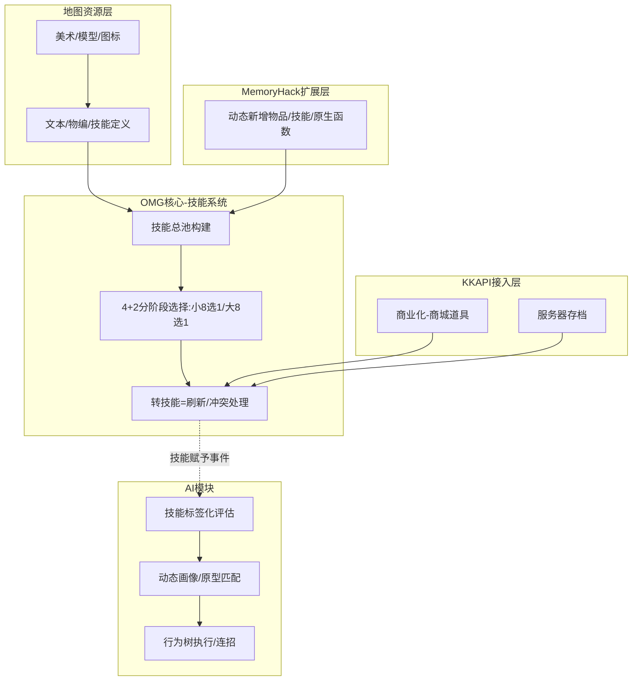
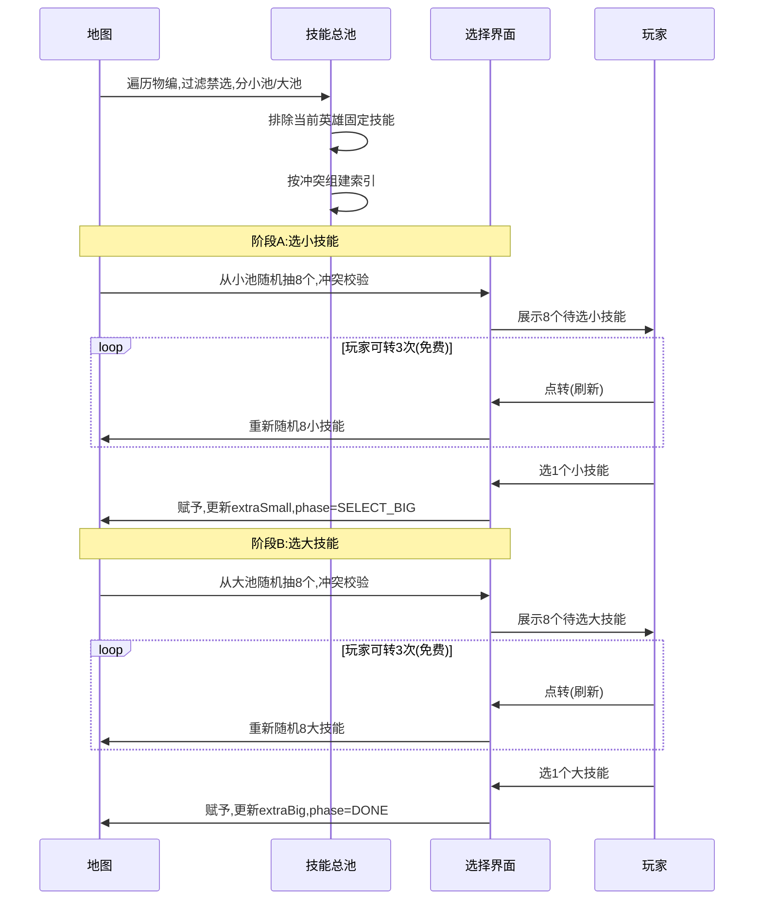
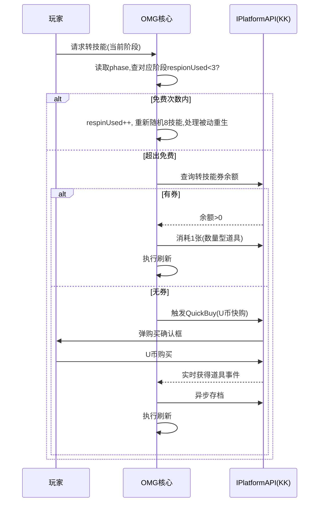
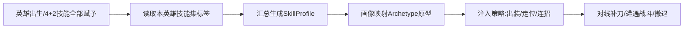

# DOTA1 OMG AI 地图 —— 调研报告与可行性方案（v1.1 已确认需求）

> **项目代号**：DOTA1-OMG-AI
> **出品**：软件开发团队（主理人 齐活林 · 交付总监）
> **撰稿**：产品经理 许清楚（市场与商业可行性） / 架构师 高见远（技术可行性与实现方案）
> **日期**：2026-10-14
> **阶段**：调研与可行性（未进入编码阶段）
> **目标平台**：KK 对战平台（主）、11 对战平台（辅）
> **修订**：v1.1 — 用户已确认核心玩法口径（4+2 分阶段模式、每局转技能、转=刷新池）

---

## 〇、主理人执行摘要（TL;DR）

本项目拟基于开源 OMG 地图 `vcccv/DOTAOMGAY`（源自 DotA 6.85sv4 LoD）改造，叠加从 `wrsuperboy/dotaai` 移植的 AI（3.3 万行已拆分），并接入 KK 平台商业化能力，打造一张 **4+2 模式（英雄固定 4 技能 + 分阶段额外选 2 技能 + 免费 3 次/付费转技能 + AI 对战）** 的盈利型 OMG 地图。

**五条核心结论：**

1. **OMG 源码可直接用**：`vcccv/DOTAOMGAY` 基于 LoD（OMG 本体），JAPI + MemoryHack 扩展技能/物品，仅支持魔兽 1.27a，活跃维护。技能选择/随机框架现成，但技能组合兼容性是重工程。

2. **AI 可移植但有核心难点**：`wrsuperboy/dotaai` 已把 AI 从地图代码中拆分（3.3 万行纯 AI），工程化程度最高，是首选移植源。**核心难点**：原版 AI 是"英雄技能固定"策略，OMG 下技能随机，AI 必须动态识别随机到的技能——需自研「技能标签化评估系统」攻坚。

3. **K 币有合规现成方案（重大利好）**：KK 平台提供完整 KKAPI（兼容 DzAPI）——服务器存档 + 地图商城道具系统（U 币购买/数量型道具/快速购买/实时事件）+ 轻量服务端。**"转技能券"直接做成平台商城道具，玩家 U 币购买→地图内 API 消耗**，无需自建支付/服务器，且合规风险由平台承担。**强烈建议放弃自建 K 币方案。**

4. **平台策略明确**：KK 平台是唯一能实现"赚钱"目标的平台（内购分成、作者分成比例行业两倍以上、单图最高流水近 7000 万），为主战场；11 平台全免费无内购 API，作辅战场做品牌曝光/引流，上"功能降级版"。

5. **最大风险变量是 AI 质量与技能兼容工程量**，二者决定项目成败；版权与合规风险在走平台正规通道后可控。

---

## ★ 用户已确认的核心玩法口径（4+2 分阶段模式）

| 项 | 确认结果 |
|----|----------|
| 免费转技能次数口径 | **每局**重置（非终身） |
| 模式 | **4+2**：英雄固定 4 个技能（原版 3 小 + 1 大）+ 额外选 2 个技能（1 小 + 1 大） |
| 选技能流程 | **分两阶段**：先选小技能，再选大技能 |
| 选小技能 | 从全英雄小技能总池随机抽 **8 个**供选择，玩家选 **1 个**；可免费**转（刷新）3 次/局**，第 4 次起花 K 币（券） |
| 选大技能 | 小技能选定后，从全英雄大技能总池随机抽 **8 个**供选择，玩家选 **1 个**；可免费**转（刷新）3 次/局**，第 4 次起花 K 币（券） |
| 1 小 + 1 大比例 | **固定** |
| "转技能"语义 | **刷新当前阶段的 8 技能随机池**（重新发牌）；选技能动作本身不消耗次数，消耗的是刷新动作 |
| 技能池来源 | **所有英雄的技能汇总成一个总随机池**，从中抽取 8 个 |

---

# 第一部分 · 市场与商业可行性分析

> 撰稿：产品经理 许清楚

## 一、市场需求与机会分析

### 1.1 OMG 模式热度

OMG 是 DOTA 自定义地图中运营超过十年的经典玩法，核心魅力在于脱离英雄技能绑定，玩家从全英雄技能池中自由搭配技能组合。

| 维度 | 现状 |
|------|------|
| DOTA2 OMG | 游廊自定义模式热度前三，但整体占比约 1%，属小众但高粘性品类 |
| DOTA1 OMG | 经典 10 选 4 / 20 选 6 模式，在 Warcraft 3 平台有长期用户基础；LoD（Legends of Dota）是其主流魔兽版本 |
| 核心玩法 | 技能征召（最主流）、随机技能（娱乐）、特殊规则（无 CD/死后换技能等） |
| 用户核心诉求 | "强势技能组合"占 47%，"选技能优先级"占 29%——**玩家为"玩得爽、能赢"付费意愿极强** |

**关键机会点：** OMG 在 DOTA2 游廊中占比仅约 1%，但这恰恰说明该品类**在 War3/DOTA1 生态中有独立空间**——KK 平台设有 Dota1 游廊专区，存在一批不玩 DOTA2 但坚守 War3 对战的老玩家。OMG 是这批用户最熟悉的自定义对战模式之一。

### 1.2 目标用户画像

| 用户属性 | 画像描述 |
|----------|----------|
| 年龄 | 30 岁以上"老男孩"，玩澄海 3C/真三国无双/守卫剑阁长大 |
| 收入 | 有稳定收入，付费意愿强且持续，ARPU 值高 |
| 消费偏好 | 偏理性、内容向——愿意为玩法深度、游戏时长、英雄数值等实质性内容付费 |
| 社交行为 | 拉老朋友开房联机，社交属性大于游戏本身；忠诚度高、粘性强 |
| 对地图要求 | 玩法深度、数值平衡、操作手感要求高，一张地图要能反复玩数月甚至数年 |

### 1.3 AI 功能带来的增量价值

| 传统 OMG 痛点 | AI 地图解决方案 |
|---------------|-----------------|
| 需要 10 人才能开局，凑人难 | AI 补位，1 人即可开局，大幅降低门槛 |
| 新手被老玩家碾压，负反馈大 | AI 难度可调，新手有过渡空间 |
| 排队等人的时间成本高 | 随时开局，碎片化时间利用 |

**结论：AI 是降低开局门槛、提升单机体验的必备能力。** 但需注意头部竞品（见 1.4）已具备强 AI，AI 不再是独占差异化点——本项目差异化应放在 **4+2 分阶段玩法 + 付费转技能机制 + 后续定制** 上，AI 目标是"追平可用"而非"超越"。

### 1.4 竞品分析：DOTA AI OMG（dotaaiomg.cn）

用户提供的直接竞品，已运营多年，是本项目最重要的参照对象。

| 维度 | 竞品现状 | 对本项目的启示 |
|------|----------|----------------|
| 开发规模 | 社区项目，迭代 5 年+，400+ 版本，底层代码全部重写 | 竞品极成熟，正面硬刚难度大，须差异化 |
| 平台 | KK 为主（地图名"英雄守护达拉然"规避 DOTA 商标）；**11 平台已永久停更** | 验证"专注 KK、11 不值得"判断；改名规避商标 |
| 商业模式 | **免费无氪** + 网站打赏作者（非内购） | 竞品免费，本项目走付费内购是差异化也是挑战 |
| AI | 超强人机 AI，"暴打普通玩家" | 竞品 AI 已强(5 年调优)，本项目 AI 目标"追平可用"而非"超越" |
| 玩法 | 经典 OMG：-nengap，120 秒选 3 小+1 大+模型，全池选 4 | 本项目 4+2 分阶段+付费转技能=玩法差异化 |
| 技术突破 | 完美支持任意英雄多重施法、**任意变身效果叠加**、装备同步 Dota2 | 变身冲突竞品已解决，可参考其思路缩短 R1 |
| 工具生态 | 更新日志/测试命令生成器/崩溃日志发送/命令大全/许愿池/技能投票榜/QQ 群/直播 | 竞品运营护城河深，本项目长期要补，MVP 先聚焦核心 |

**竞品已趟过的坑（可直接借鉴避坑，缩短 R1 工程量）：**
- 变身类技能冲突（德鲁伊变熊/龙骑真龙形态/美杜莎分裂箭等）— 竞品已解决
- 重击类不叠加（虚空时间锁定/火枪爆头/鱼人重击）
- 法球类不叠加（智慧之刃/法力损毁/腐蚀攻击）
- 卡尔冰雷火/元素召唤、地卜师大招需特殊处理
- AI 挂机不出装（AI 脚本文件缺失导致）— 须保证 AI 脚本完整性
- 技能选择界面卡死（冷门魔改技能组合逻辑死锁）— 须逻辑校验
- 版本兼容（1.20 不支持大地图，须 1.24e/1.27a）
- 地图文件被第三方下载器篡改 — 须正规渠道分发

**竞品机制细节（可借鉴）：**
- AI 难度调节：`-cg X`（XM 模式，X=1-1000，每点提高动态经验/金钱加成）；`-neng` 切回正常难度；`-fl` AI 分路推进（16 级后）；`-fuck` AI 行为增强（更积极用物品技能/关闭打野）
- 外观定制：`-tx 1-35` 武器/身体特效、`-cb` 翅膀外观（不影响数值）——竞品已有外观定制，验证"定制英雄=外观差异"方向
- 复活节奏：`-sr` 快速 25%/`-dr` 慢速 2 倍/`-gr` 动态递增；胜利条件 `-sl 人头数`
- 测试工具：`-omgtest 楼层 英雄ID 小技能ID 大招ID` + 网站测试命令生成器（说明竞品额外技能也是 1 小+1 大结构，与本项目 4+2 一致）
- 平台：魔兽 1.27；`-wjlt` 命令明确"11 平台无效"（11 已停更再次验证）

**竞品故障修复命令暴露的踩坑（直接对应本项目技术风险，需架构层预防）：**
- `-fixskill` 切换型技能无法使用 → R1 变身/切换技能兼容
- `-fixstun` 暂停/眩晕异常残留 → 状态机残留 bug（需统一状态清理）
- `-fixmodel`/`-fixunit` 模型异常/消失 → 换技能/变身导致模型错乱
- `-fixstate` 永久负面状态残留 → buff/debuff 清理
- `-fixdbs`/`-fixdg` 地卜师/电狗分身头像异常 → 分身单位管理
- `-aiunstuck` AI 卡住 → R2 AI 路径/行为死锁

竞品用"修复命令"兜底说明这些坑难以根治，本项目须在架构层预防而非靠命令补救。

**战略结论（竞品分析后调整）：**
1. **差异化定位** = 4+2 分阶段玩法 + 付费转技能 + 后续定制技能/英雄，不与竞品拼"免费全池 OMG"
2. AI 目标调整为"追平可用"，不押注"超越竞品 AI"
3. 专注 KK（竞品已验证 11 不值得）
4. 变身/重击/法球冲突规则可直接借鉴竞品方案，缩短 R1 工程量
5. 长期补齐工具生态（崩溃日志/许愿池/投票），但 MVP 不做

---

## 二、平台对比与上架策略

| 对比维度 | 11 对战平台 | KK 对战平台（网易） |
|----------|------------|---------------------|
| 建主方式 | 纯服务器建主 | 服务器建主 |
| 反作弊 | 强 | KAC 系统，改图工具直接封禁 10 年 |
| 收费模式 | 全程免费、无 VIP、无收费属性道具 | 地图内购分成（核心商业模式） |
| 作者商业化 API | 无 | KKAPI（兼容 DzAPI），完整商城道具系统 |
| 作者分成 | 不适用 | 行业常规两倍以上（估约 50%-70%），阶梯式 |
| 作者扶持 | 无系统性扶持 | 新人保底推广金、首周 DAU 阶梯激励、新图流量倾斜（约 1 个月） |
| 推广员系统 | 无 | 有——玩家拉新可获被邀者内购 10%-50% 分成 |
| DOTA1 专区 | 有收录 | 有 Dota1 游廊专区 |
| 开发者平台 | 无 | https://create.reckfeng.com/ ，QQ 群 433807374 |
| 存档能力 | 无服务器存档 | 服务器存档（KKAPI） |
| 定位 | 纯竞技对战，免费 | UGC 商业化生态 |

**上架策略：KK 为主战场（唯一能盈利），11 为辅战场（上"功能降级版"做引流）。** 11 平台运行时 KKAPI 不生效，需优雅降级为纯免费模式；KK 平台运行时启用完整商业化功能。

---

## 三、商业模式方案

### 3.1 K 币 → 平台商城道具的映射方案

**原方案（自建 K 币）：强烈不推荐**——自发行虚拟货币需省级文化部门审批备案、保存交易记录 2 年、禁止兑换法币，违规罚款最高 3 万。

**推荐方案（KK 平台商城道具）**：
- "K 币购买转技能次数" → KK 开发者平台创建道具「转技能券」（数量型，3 次/6 次/10 次礼包）
- 玩家用 U 币在平台商城购买 → 进入背包 → 地图内 KKAPI 查询余额、消耗
- 支持 `DzAPI_Map_QuickBuy` U 币快速购买 + 实时获得道具事件
- 原"作者后台手动加 K 币" → 改为平台后台管理道具发放/活动赠送
- 合规风险由平台承担，无需自建支付/服务器

### 3.2 转技能付费点设计

| 付费点 | 设计逻辑 | 定价建议 |
|--------|----------|----------|
| 免费 3 次转技能（每阶段） | 吸引体验核心乐趣 | 免费 |
| 额外转技能次数包 | 核心付费转化点 | 6 元/3 次，12 元/6 次，18 元/10 次 |
| 技能刷新加速 | 不满意当前 8 个可选技能，付费刷新一批 | 3 元/次 |
| 技能预设保存位 | 保存多套技能搭配方案 | 6 元/扩展 3 个槽位 |

### 3.3 转化漏斗

```
进入地图玩家(100%) → 用完免费转(80%) → 产生付费意愿(25-35%) → 首次付费(8-15%) → 持续付费(3-6%)
```

### 3.4 后续付费扩展

| 阶段 | 付费内容 |
|------|----------|
| V1.0 | 转技能次数包、技能刷新 |
| V1.5 | 技能预设保存位、AI 难度选择 |
| V2.0 | 定制技能（玩家设计/投稿，付费上架） |
| V2.5 | 定制英雄模型（外观差异，不影响数值） |
| V3.0 | 赛季通行证 |

**注意：** PvP 地图付费设计注意竞技公平。转技能付费属"付费获取更多选择机会"而非"更强属性"，类似自走棋刷新，可接受。定制英雄限定外观差异。

---

## 四、合规与版权风险分析

| 风险项 | 等级 | 规避建议 |
|--------|------|----------|
| Blizzard 版权（魔兽地图） | 🟡 中 | 不脱离平台独立发行；上架平台即获版权背书；不做手游移植 |
| Valve DOTA 商标 | 🟡 中 | 地图名避免独立使用"DOTA"作商标，可用"OMG"或自创名 |
| 自建虚拟货币合规 | 🔴 高 | **放弃自建 K 币，改用 KK 平台商城道具系统** |
| 改图/作弊 | 🟢 低 | 服务器建主，敏感数据放服务端 |
| 平台政策变动 | 🟡 中 | 加开发者 QQ 群关注；API 版本兼容；11 保留入口 |
| 竞技公平性争议 | 🟡 中 | 定位"更多选择机会"而非"更强属性"；技能池对所有人相同 |

**核心结论：放弃自建 K 币方案后，所有风险均可控。**

---

## 五、收益预估

**参考对标（KK 公开报道）：** 《万千世界》4 人首月破百万；《爆战兄弟》<10 人月流水破千万；《暴走英雄》5 人 4 个月 600 万；《进化吧僵尸》个人 2 个月破百万。

| 情景 | 假设 | 月 DAU | 付费转化 | ARPPU | 月流水（平台总） | 月作者到手(50-70%) | 年化到手 |
|------|------|--------|----------|-------|------------------|-------------------|----------|
| 悲观 | 质量一般、无推荐、AI 未达预期 | 3K-8K | 5% | 8-12 元 | 1.2K-4.8K | 0.6K-3.4K | 0.7 万-4 万 |
| 中性 | 质量合格、获流量倾斜 | 10K-25K | 8-10% | 12-20 元 | 9.6K-50K | 4.8K-35K | 5.8 万-42 万 |
| 乐观 | AI 优秀、成 OMG 品类头部 | 30K-60K | 12-15% | 20-35 元 | 72K-315K | 36K-220K | 43 万-265 万 |

**核心变量：AI 质量。**

---

# 第二部分 · 技术可行性与实现方案

> 撰稿：架构师 高见远

## 一、总体技术架构

**技术选型**：JASS（YDWE 扩展）+ 1.27a + MemoryHack + KKAPI，与 `vcccv/DOTAOMGAY` 完全同构。



**三大架构决策：**
1. **数据驱动**：技能定义、AI 标签、冲突规则均以配置数据存储，后续定制只需扩展数据。
2. **IPlatformAPI 抽象层**：KK 接 KKAPI 实现，11 接空实现（降级），业务代码不直接依赖平台 API。
3. **AI 与核心解耦**：AI 通过"技能标签读取"接口获取当前技能集，不直接依赖具体技能 ID。

---

## 二、OMG 技能系统改造方案（4+2 分阶段模式，已与用户确认）

### 2.1 改造要点与口径定义

**4+2 模式**：每个英雄固定保留原版 4 个技能（3 小 + 1 大），再额外选 2 个技能（1 小 + 1 大），**分两阶段独立选择**：

- **阶段 A 选小技能**：从全英雄小技能总池随机抽 **8 个**供选择，玩家选 **1 个**；可免费**转（刷新）3 次/局**，第 4 次起花 K 币（券）
- **阶段 B 选大技能**：小技能选定后，从全英雄大技能总池随机抽 **8 个**供选择，玩家选 **1 个**；可免费**转（刷新）3 次/局**，第 4 次起花 K 币（券）
- **"转技能" = 刷新当前阶段的 8 技能随机池**（重新发牌），选技能动作本身不消耗次数
- **技能池来源**：所有英雄的技能汇总成一个总随机池，从中抽取 8 个
- **被动技能重生**：转技能刷新池后，重新赋予的被动需考虑重生刷新（实现阶段处理，避免旧被动残留）

### 2.2 核心数据结构

**SkillDef（技能定义 + AI 标签）**
```
SkillDef {
  abilityId        // 技能ID（MemoryHack动态注册）
  name             // 技能名
  slot             // SMALL | BIG
  fixedOn          // 固定于哪些英雄（可空，额外池技能为空）
  // AI标签
  dmgType          // PHYSICAL | MAGICAL | PURE
  dmgScale         // 0-10 伤害量级
  ctrlMask         // 控制类型位掩码(STUN/SLOW/SILENCE...)
  ctrlDuration     // 控制时长(秒)
  healScale        // 0-10 治疗/续航量级
  isPassive        // 是否被动
  isDash           // 是否位移
  rangeCat         // MELEE/SHORT/LONG/GLOBAL
  cooldownTier     // 冷却档位
}
```

**PlayerSkillState（玩家技能状态 — 4+2 分阶段）**
```
PlayerSkillState {
  fixedSkills[4]          // 英雄原版4技能(3小+1大)
  extraSmall              // 阶段A已选小技能
  extraBig                // 阶段B已选大技能
  smallOffers[8]          // 阶段A当前面板8个待选小技能
  bigOffers[8]            // 阶段B当前面板8个待选大技能
  smallPhaseRespinUsed    // 阶段A本局已用免费转次数
  bigPhaseRespinUsed      // 阶段B本局已用免费转次数
  voucherBalance          // 转技能券余额(从KK存档读取)
  phase                   // SELECT_SMALL | SELECT_BIG | DONE
}
```

**ConflictRule（冲突规则）**
```
ConflictRule {
  groupId             // 冲突组ID
  policy              // 0=同组单生效 | 1=全禁选 | 2=特殊处理
  members[]           // 成员技能ID
}
```

### 2.3 技能总池构建与分阶段选择流程



### 2.4 转技能（刷新）流程 — 含付费



### 2.5 冲突策略表

| 冲突类型 | 策略 | 示例 |
|----------|------|------|
| 法球/攻击特效 | 同组单生效（取最高优先级） | 智慧之刃、法力损毁、腐蚀攻击 |
| 变身类 | 全局禁选 | 德鲁伊变熊、龙骑真龙形态、美杜莎分裂箭 |
| 需弹道系统 | 兼容补丁/暂禁 | 窒息之刃 + 远程动态暴击 |

---

## 三、AI 实现方案（核心难点）

### 3.1 AI 源码选型：推荐 `wrsuperboy/dotaai`

| 候选 | 优势 | 劣势 | 结论 |
|------|------|------|------|
| `wrsuperboy/dotaai` | AI 已从地图代码拆分（3.3 万行纯 AI vs 9.3 万行地图），工程化程度高，便于定位硬编码技能 ID | 需自行标签化改造 | **首选** |
| `anyushun/DotaAI` | 按英雄分类 | 2018 年项目较老，按英雄固定策略 | 次选 |

### 3.2 移植路径（5 步）

1. 从 13 万行 all-in-one 提取 3.3 万行 AI 段落
2. 搜索 `GetUnitAbilityLevel` 等调用，标记硬编码技能 ID 点
3. **标签化改造**：`if HasAbility(英雄,暴击ID)` → `if SkillProfile.hasTag(CTRL_HIGH_BURST)`
4. 集成进 OMG 地图脚本，接入技能赋予事件（含 4+2 两阶段赋予）
5. 行为回归测试调优

### 3.3 核心难点攻坚——技能标签化评估系统

**问题本质：** 原版 AI 是"固定技能→固定策略"脚本，OMG 随机技能下 AI 不认识自己的技能。

**解决方案（创新点）：** 运行时根据随机到的技能标签动态生成画像，匹配原型，注入策略。



**SkillProfile（技能画像）**
```
SkillProfile {
  burstScore       // 爆发分 0-10
  sustainScore     // 续航分
  controlScore     // 控制分
  mobilityScore    // 机动分
  durabilityScore  // 承伤分
}
```

**5 种原型（初版）**

| 原型 | 触发条件 | 出装 | 连招 |
|------|----------|------|------|
| 爆发法师 | burst≥7 且魔法为主 | 法系爆发 | 先手控制→连招秒杀→撤退 |
| 坦克控制 | control≥6 且 durability≥5 | 肉 + 控制 | 开团→吸收→持续控制 |
| 核心续航 | sustain≥6 且物理为主 | 攻速暴击 | 持续输出→续航→收割 |
| 游走刺客 | mobility≥4 且 burst≥5 | 穿透爆发 | 位移切入→秒杀→撤离 |
| 辅助控制 | control≥5 且 heal≥3 | 团队装 | 控制→治疗→辅助 |

**连招执行（标签驱动）：** 先手找眩晕控制 → 找最高伤害爆发 → 残血找治疗 → 撤退找位移。

**AI 战略定位（已与产品对齐）：** MVP 目标"不卡死、行为合理"而非"优秀"，持续调优是长期投入护城河。

### 3.4 AI 分阶段路线

| 阶段 | 目标 |
|------|------|
| MVP | 5 原型 + 对线 + 连招 |
| 增强 | 团战配合 + 动态出装 + 扩展到 8 原型 |
| 定制 | 每原型可配策略 + 难度分级 |

---

## 四、K 币/充值技术方案

### 4.1 K 币 → KKAPI 映射

| 原 K 币概念 | KKAPI 实现 |
|-------------|-----------|
| K 币 | KK 开发者平台"转技能券"道具（数量型） |
| 玩家充值 | U 币在平台商城购买转技能券 |
| 作者加 K 币 | 轻量服务端/开发者后台发放 |
| 消耗 | 地图内 `DzAPI_Map_ConsumeMallItem`，每次转技能消耗 1 张 |
| 持久化 | KKAPI 服务器存档 |

**无需自建支付/服务器。**

### 4.2 服务器存档结构

```
PlayerSaveData {
  uid                  // 玩家唯一ID
  totalReskinVouchers  // 累计转技能券
  totalReskinUsed      // 累计已用
  customSkills[]       // 已解锁定制技能
  customHeroes[]       // 已解锁定制英雄
  stats                // 战绩统计
}
```

### 4.3 购买→生效时序（见 2.4 转技能流程图）

### 4.4 11 平台降级方案

| 方案 | 可行性 | 推荐 |
|------|--------|------|
| 免费无限转技能 | 无 KKAPI 也能跑 | **推荐** |
| Preload 本地存档 | 有限且可被篡改 | 不推荐 |
| 自建 Web 充值 | 运营成本高、合规风险 | 不推荐 |

**K 币收入集中在 KK 平台。** 11 平台只做引流 + 免费体验。

---

## 五、后续定制能力技术预留

**数据驱动设计：**
- **定制技能**：新增 SkillDef 条目（abilityId 由 MemoryHack 动态注册）+ 补 AI 标签 → 自动纳入选择/冲突/AI，无需改核心逻辑。
- **定制英雄**：新增 HeroDef 条目 → 自动加载，AI 基于画像不依赖英雄 ID。

**ICustomContentProvider 接口**：KKCustomContentProvider（服务器存档拉取）/ LocalCustomContentProvider。未来"玩家定制内容"→ 作者制作 → 存档标记解锁 → 地图拉取注入技能池。

---

## 六、技术风险与难点清单

| # | 风险 | 等级 | 应对 |
|---|------|------|------|
| R1 | 技能组合兼容性工程量巨大 | 🔴 高 | 起步小技能池 60-80 个逐步扩展；自动化冲突测试；复用 vcccv 已有兼容成果 |
| R2 | AI 适配 OMG 随机技能（社区无先例） | 🔴 高 | 技能标签化评估系统；先 5 原型覆盖；持续调优阈值 |
| R3 | 跨平台 API 差异 | 🟡 中 | IPlatformAPI 抽象层；11 平台降级免费 |
| R4 | 内存泄漏（handle 累积崩溃） | 🔴 高 | handle 管理规范；leak checker 扫描；封装自动清理 |
| R5 | 版本兼容（仅 1.27a） | 🟡 中 | 加载时版本检测；发布说明 |
| R6 | 版权合规 | 🟡 中 | 检查开源 License；原创美术优先；遵守平台审核 |
| R7 | 3.3 万行 AI 移植量 | 🟡 中 | 分阶段提取→标签化→调优；回归测试基线 |
| R8 | 4+2 分阶段被动重生处理 | 🟡 中 | 转技能刷新时统一处理旧被动移除/新被动赋予 |

---

## 七、实施路线图

| 阶段 | 周期 | 核心任务 | 里程碑 |
|------|------|----------|--------|
| ① 调研深化 | 1-2 周 | 编译 vcccv 基线；提取分析 dotaai AI；搭建 YDWE；初选 60-80 技能 | 可编译 OMG 基线 + AI 分析报告 + 技能池初版 |
| ② MVP | 3-4 周 | 4+2 技能系统(分阶段 8 选 1+各 3 免费转)；基础 AI(5 原型+标签化)；KKAPI 券+存档 | KK 平台可玩 MVP |
| ③ 内测 | 2 周 | 兼容性批量测试；AI 调优；内存泄漏审计 | 稳定 Beta |
| ④ 上架 | 1 周 | KK 提交审核；11 降级版；发布说明 | 双平台正式上架 |
| ⑤ 迭代 | 持续 | 扩展技能池 100+；AI 增强 8+ 原型+团战；定制技能/英雄 | v1.1 持续更新 |

---

## 八、待明确事项（需求确认状态）

| # | 事项 | 状态 | 确认结果 |
|---|------|------|----------|
| U1 | 免费 3 次是每局还是终身 | ✅ 已确认 | **每局** |
| U2 | 选技能口径 | ✅ 已确认 | **4+2 分两阶段**：先小技能 8 选 1(可转 3 次)，再大技能 8 选 1(可转 3 次) |
| U3 | 1 小 + 1 大比例是否固定 | ✅ 已确认 | **固定 1+1** |
| U4 | 转技能语义 | ✅ 已确认 | **转=刷新当前阶段 8 技能随机池**；被动重生刷新留实现阶段处理 |
| U5 | KK 平台道具审核周期与抽成 | ⏳ 待核实 | 注册开发者后确认 |
| U6 | 11 平台是否允许引导玩家去 KK | ⏳ 待核实 | 上架前确认 |
| U7 | wrsuperboy/dotaai License 是否允许商用 | ⏳ 待核实 | 提取源码前必查 |

---

# 第三部分 · 主理人汇编结论与下一步行动

> 撰稿：主理人 齐活林 · 交付总监

## 结论

1. **项目可行**。OMG 源码、AI 源码、K 币合规通道三条技术线均有现实落点，无技术性死路。
2. **盈利模式成立**。KK 平台内购分成是经过大量地图验证的成熟路径，OMG 品类付费意愿强。
3. **核心玩法口径已锁定**：4+2 分阶段模式（英雄固定 4 技能 + 分阶段额外选 1 小 + 1 大，各阶段 8 选 1 可转 3 次，转=刷新池）。
4. **两个高难度攻坚点**：AI 适配随机技能（需自研标签化评估系统）、技能组合兼容工程量。二者决定成败。
5. **放弃自建 K 币**，全面采用 KK 平台商城道具系统——合规、省力、体验更好的唯一正解。
6. **竞品 dotaaiomg 已极成熟**（5 年/400 版本/免费/强 AI/变身已解决/11 已停更专注 KK），本项目须差异化定位：4+2 分阶段玩法 + 付费转技能 + 后续定制，不拼免费全池；AI 目标"追平可用"非"超越"；变身/重击/法球冲突规则直接借鉴竞品方案缩短 R1 工程量。

## 下一步行动建议

1. **核实 U5/U6/U7 三项**（注册 KK 开发者、查 dotaai License）——这些决定能否商用上架。
2. **进入调研深化阶段（阶段①）**：编译 vcccv 基线地图、提取分析 dotaai 3.3 万行 AI、搭建 YDWE 工具链、初选 60-80 个技能入池（按 4+2 分小/大池）。
3. **注册 KK 开发者**：https://create.reckfeng.com/ 实名认证 + QQ 群 433807374。
4. **MVP 范围锁定**：V1.0 只做"4+2 分阶段选技能 + 各 3 次免费转/付费 + 基础 5 原型 AI"，定制技能/英雄放 V2.0+。
5. **团队组建**：1 名 JASS/魔兽地图开发 + 1 名 AI 行为逻辑 + 1 名运营（兼顾 KK 后台/社区）。

---

## 附录 · 关键调研信息来源

| 主题 | 来源 |
|------|------|
| OMG 源码 | https://github.com/vcccv/DOTAOMGAY （基于 DotA 6.85sv4 LoD，JAPI+MemoryHack，1.27a） |
| AI 源码 | https://github.com/wrsuperboy/dotaai （3.3 万行 AI 已拆分）；https://github.com/anyushun/DotaAI |
| 魔兽脚本 | JASS（1.16+）/ Lua（1.31+，转译混合）；MemoryHack；Preload 存档 |
| KK 平台商业化 | KKAPI 开发者文档 https://create.reckfeng.com/kkapidoc/ ；商城道具/QuickBuy/服务器存档/轻量服务端；DzAPI 兼容 |
| 平台运营 | KK 负责人启明公开访谈（分成比例、扶持政策、用户画像）；11 平台定位（全免费无内购） |
| 版权 | Blizzard EULA（custom games 版权归 Blizzard）；2012 Blizzard vs Valve 和解；Blizzard v Lilith 案 |
| OMG 机制 | DotA 中文维基（技能征召/OMG）；LoD 模式命令（-s5/-s6/-ak/-Ra）；法球/变身冲突规则 |

---

*报告 v1.1 完。核心玩法口径已与用户确认锁定。待核实 U5/U6/U7 后可进入阶段①调研深化与 MVP 开发。*
